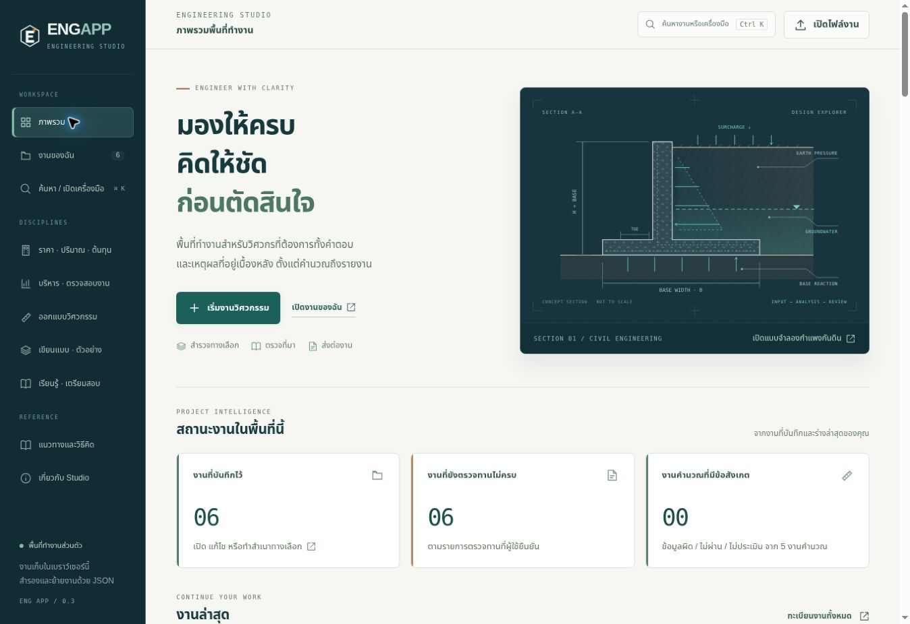

# ENG APP — Engineering Studio

เว็บแอปภาษาไทยสำหรับคำนวณ ถอดปริมาณ ประมาณราคา วางแผน และตรวจงาน สร้างขึ้นใหม่จากโครงหมวดและข้อมูลสาธารณะที่มองเห็นบน [ช่างคิด Engineering Apps](https://changkid-engapp.com/) ตามคำขอของเจ้าของ repository โดยไม่เข้าสู่ระบบต้นแบบ

**20 เครื่องมือเปิดใช้งานได้ทันที โดยไม่ต้องสร้างบัญชี** ทุกโมดูลมีตัวอย่างให้ลอง มีชื่อโครงการ บันทึกงาน เปิดงานเดิม ส่งออก/นำเข้า JSON และพิมพ์รายงานผ่านเบราว์เซอร์ ข้อมูลอยู่ในเบราว์เซอร์ของผู้ใช้ ไม่มีบัญชีสมาชิกหรือ server เก็บงาน

รุ่นนี้เป็น implementation อิสระในขอบเขตที่ระบุบนแต่ละหน้า ไม่ใช่สำเนา source code และไม่อ้างว่ามีฟังก์ชันภายในทั้งหมดเหมือนต้นแบบ ภาพร่าง โลโก้ บทเรียน และแบบฝึกหัดเขียนขึ้นใหม่

## รุ่น 0.3 — Engineering Studio

พื้นที่ทำงานใหม่สำหรับตรวจทางเลือกและส่งต่องานวิศวกรรม พร้อมรักษาแบบจำลองและขอบเขตที่ตรวจไว้ในรุ่นก่อน

- **ภาพรวมจากข้อมูลจริงในเครื่อง:** จำนวนงาน งานที่ผู้ใช้ยังตรวจทานไม่ครบ และงานคำนวณที่มีข้อมูลผิด/ผลไม่ผ่าน/ผลไม่ประเมิน แสดงเป็นคนละสถานะ
- **มุมมองการวิเคราะห์ 4 ส่วน:** ผลคำนวณ, เปรียบเทียบ A/B, ศึกษาความไว และวิธีคำนวณ แยกผลลัพธ์ออกจากรายละเอียดที่ต้องเปิดตรวจ
- **ศึกษาความไว 9 จุด:** เลือกตัวแปรต่อเนื่องและผลลัพธ์ ปรับช่วง ดูกราฟ/ตาราง แล้วเลือกใช้ค่าหนึ่งอย่างชัดเจน ตั้งค่าแนบผลศึกษาในรายงานได้
- **ข้อมูลเอกสาร:** รหัสโครงการ ลูกค้า สถานที่ ผู้จัดทำ ผู้ตรวจทานที่ระบุ ฉบับแก้ไข วันที่ และแหล่งข้อมูล ติดไปกับงานและหน้าปกรายงาน
- **รายการตรวจทานของผู้ใช้:** แยกจากผลคำนวณอัตโนมัติ เมื่อแก้ข้อมูลหรือบริบทที่เคยตรวจ เครื่องหมายยืนยันถูกล้างให้ตรวจรอบใหม่ โดยเก็บบันทึกไว้
- **เปิดงานเร็ว:** Ctrl/⌘ + K ค้นหาเครื่องมือ งานที่บันทึก และคำสั่งใช้งาน พร้อมปุ่มลูกศร/Enter; ทะเบียนงานค้นได้ด้วยรหัสโครงการและลูกค้า
- **ระบบภาพใหม่:** แถบนำทางถาวร ภาพหน้าตัดต้นฉบับ สีและตัวอักษรที่ใช้ร่วมกันทั้งแอป เมนูด้านล่างบนมือถือ และหน้าปกรายงานที่มีข้อมูลควบคุมเอกสาร



ดูแนวทางออกแบบ ขอบเขต และหลักฐานทดสอบใน [บันทึกรุ่น 0.3](docs/studio-0.3.md)

## รุ่น 0.2 — รีวิวความถูกต้องและเพิ่มเครื่องมือทำงาน

- เปรียบเทียบค่า **A กับค่าปัจจุบัน** ในเครื่องคำนวณทั้ง 9 ตัว แสดงผลต่าง ข้อมูลที่เปลี่ยน และสถานะตรวจ พร้อมเก็บในไฟล์งานและรายงาน
- ทำสำเนาโครงการ ค้นหา/เรียงงาน เห็นป้ายฉบับร่าง และกลับไปยังเครื่องมือที่ใช้ล่าสุดได้
- BOQ คัดลอก/ย้ายแถวและย้อนรายการล่าสุดได้; แผนงานเทียบความก้าวหน้าตามแผนกับผลงานที่กรอก ณ วันที่ประเมิน
- วัดภาพแบบซูมได้ถึง 4× เลือกไฮไลต์รายการบนภาพ และคืนรายการที่เพิ่งลบได้
- แก้โมเดลน้ำหนักบน heel กำแพง เงื่อนไขแรงยก รูปทรงดาดคลอง และความละเอียดดัชนีปรับราคา พร้อม regression tests
- ตรวจไฟล์นำเข้าเข้มขึ้น ไม่แทนค่าผิดด้วยตัวเลขตัวอย่าง ไม่ตัดรายการเกินขอบเขตทิ้งเงียบ ๆ และไม่พิมพ์รายงานจากข้อมูลไม่ครบ

รายละเอียดสิ่งที่พบและวิธีตรวจแก้อยู่ใน [บันทึกรีวิวรุ่น 0.2](docs/review-0.2.md)

## เปิดบนเครื่อง

ต้องมี **Node.js 22 ขึ้นไป** ไม่มี dependency ให้ติดตั้ง

```bash
git clone https://github.com/saratchai1/eng-app.git
cd eng-app
npm run dev
```

เปิด `http://localhost:5173` ใน Chrome, Edge, Firefox หรือ Safari รุ่นปัจจุบัน หากต้องการเปลี่ยนพอร์ต:

```bash
npm run dev -- --port 8080
```

หากกำลังตรวจงานก่อน merge ให้ checkout branch ของ PR ก่อน `npm run dev`:

```bash
git fetch origin
git switch codex/1-engineering-workbench
```

ห้ามเปิด `index.html` ด้วย `file://` เพราะ ES modules ต้องโหลดผ่าน HTTP server ใช้คำสั่งด้านบนแทน

## สิ่งที่ใช้งานได้

| หมวด | จำนวน | ขอบเขตที่ทำแล้ว |
| --- | ---: | --- |
| ราคา · ปริมาณ · ต้นทุน | 11 | BOQ อาคาร/ถนน/ชลประทาน/โกดัง, ปริมาณอาคาร/ชั้นทาง/คลอง, คลังราคากรอกเอง, ดัชนีถ่วงน้ำหนัก, วัดภาพแบบ, คู่มือประมาณราคา |
| บริหาร · ตรวจสอบงาน | 2 | แผนงาน Gantt/CPM และความก้าวหน้าถ่วงน้ำหนัก; checklist ตรวจบ้านพร้อมบันทึกข้อบกพร่องและรูป |
| ออกแบบวิศวกรรม | 5 | เสถียรภาพกำแพงกันดิน, แรงดัดคานและแถบพื้นทางเดียว, แรงกดฐานรากเยื้องศูนย์, ภาระแนวดิ่งนั่งร้าน |
| เขียนแบบ · ตัวอย่าง | 1 | ภาพร่างต้นฉบับ 6 แบบ ดาวน์โหลด SVG ได้ |
| เรียนรู้ · เตรียมสอบ | 1 | คำถามพื้นฐานที่แต่งใหม่ 12 ข้อ พร้อมคะแนนและคำอธิบาย |

รายละเอียดเทียบกับสิ่งที่เห็นในต้นแบบอยู่ใน [ขอบเขตต้นแบบและความต่าง](docs/reference-scope.md)

### BOQ และราคา

- เพิ่ม ลบ และแก้ไขรายการ หน่วย ปริมาณ ราคาวัสดุ และค่าแรง
- คัดลอกแถว เลื่อนขึ้น/ลง และย้อนการเพิ่ม/ลบ/ย้ายล่าสุดได้ การแก้ค่าในเซลล์จะล้างสิทธิย้อนรายการเพื่อไม่ให้ข้อมูลใหม่หาย
- คิดต้นทุนตรง ค่าอำนวยการ/กำไร และ VAT ตามค่าที่กรอก พร้อมส่งออก CSV ที่เปิดใน Excel ได้
- คลังราคาเริ่มต้นเป็น **ราคาสาธิต** ไม่ใช่ราคาปัจจุบันหรือราคาประกาศราชการ
- เปอร์เซ็นต์ค่าอำนวยการไม่ใช่ Factor F และรายงานไม่ใช่ ปร.4/ปร.5/ปร.6 ทางราชการ
- ดัชนีถ่วงน้ำหนักใช้ส่วนคงที่และตัวแปรแรงงาน/ปูน/เหล็กที่กรอกเอง ไม่ใช่ชุด 35 สูตรค่า K และยังไม่คิดเงื่อนไขชดเชยตามสัญญา

โมดูลคลองใช้ขนาดภายในหลังดาด คำนวณขอบนอกด้วยความหนาตั้งฉากกับลาดข้าง และรวมคอนกรีตบริเวณมุม ปริมาตรขุดอ้างอิงผิวนอกคอนกรีตโดยถือว่าระดับดินเดิมตรงขอบบน ยังไม่รวมชั้นรองพื้น ระยะทำงาน และค่าขยายตัวของดิน

### เครื่องมือโครงสร้างและดิน

- **กำแพงกันดิน:** Rankine สำหรับดินราบไม่มี cohesion, น้ำใต้ดินแยกจากแรงดันดินประสิทธิผล, แรงยกใต้ฐาน, FS การเลื่อน/พลิก, eccentricity และแรงกดเต็มฐาน/บางส่วน แรงดันคิดถึงใต้ฐาน และระบุ datum น้ำชัดเจน แยก surcharge ด้านข้างกับน้ำหนักแนวดิ่งบน heel; หากเป็นโหลดสม่ำเสมอที่ครอบคลุมทั้งสองบริเวณให้กรอกทั้งสองช่อง เมื่อไม่มีแรงกดสุทธิใต้ฐานจะไม่แสดง FS เป็นผลผ่าน
- **คานและพื้น:** หน้าตัดสี่เหลี่ยม เหล็กดึงชั้นเดียว f′c 17–28 MPa ใช้ φ = 0.9 เฉพาะเมื่อผ่านเกณฑ์ tension-controlled หากอยู่นอกขอบเขตจะไม่รายงานกำลังดัดที่นำไปใช้อ้างอิงได้
- **ฐานรากเยื้องศูนย์:** โมเมนต์แกนเดียว รองรับเต็มฐาน/สัมผัสบางส่วน/ไม่มีสมดุล และไม่สร้างค่าความดันดินติดลบเป็นผลผ่าน
- **นั่งร้าน:** เปรียบเทียบภาระแนวดิ่งต่อเฟรมกับ WLL ที่ผู้ใช้กรอกจากใบรับรอง รวมแรงกดแผ่นรอง

ทุกหน้ามีสมมติฐาน รายการที่ตรวจ วิธีคำนวณ หน่วย และเอกสารประกอบ **ผล “ผ่าน” หมายถึงเฉพาะเงื่อนไขที่แสดงในแบบจำลอง** ยังไม่ใช่การตรวจครบมาตรฐานหรือแบบอนุมัติก่อสร้าง ดูสมการและตัวอย่างตรวจสอบได้ใน [Engineering models](docs/engineering-models.md)

ค่าเริ่มต้นกำแพงกันดินตั้งใจให้แสดงรายการเลื่อนที่ไม่ผ่าน FS 1.5 เพื่อให้เห็นการตอบสนองต่อ input โปรแกรมไม่ได้ปรับตัวเลขให้ทุกตัวอย่างผ่าน

### เปรียบเทียบทางเลือก

1. กรอกชุดข้อมูลแรกให้คำนวณได้ เปิดแท็บ **เปรียบเทียบ A/B** แล้วกด **บันทึกค่าปัจจุบันเป็น A**
2. ปรับข้อมูล เช่น ความลึกคาน ความกว้างฐาน หรือน้ำหนักบรรทุก ตารางจะแสดงค่า A ค่าปัจจุบัน และผลต่าง
3. กด **คืนค่า A** เพื่อกลับไปชุดเดิม หรือ **ทำสำเนา** เพื่อเก็บทางเลือกเป็นอีกโครงการ

ค่า A เก็บข้อมูลเข้าและคำนวณใหม่ด้วยแบบจำลองปัจจุบัน ไม่เชื่อคำตอบสำเร็จรูปจากไฟล์นำเข้า ผลต่างของค่าที่มีหน่วย % แสดงเป็นจุดเปอร์เซ็นต์ แยกจาก % เปลี่ยนแปลงสัมพัทธ์ และไม่แสดง % สัมพัทธ์เมื่อค่า A เป็นศูนย์ ข้อมูลและผลเปรียบเทียบรวมอยู่ในรายงานด้วย

### ศึกษาความไว

1. เปิดแท็บ **ศึกษาความไว** เลือกตัวแปรที่ศึกษาและผลลัพธ์ที่ติดตาม
2. ระบุค่าต่ำ/ค่าสูงในขอบเขต กด **ศึกษาช่วงนี้** เพื่อคำนวณจริง 9 จุด โดยตรึงข้อมูลอื่น ถ้าค่าปัจจุบันอยู่ในช่วง จะรวมค่านั้นด้วย
3. อ่านผลและรายการตรวจในแต่ละจุด กราฟเว้นช่วงเมื่อข้อมูลไม่เข้าเงื่อนไขหรือไม่มีผลเชิงตัวเลข ค่าไม่ประเมินไม่ถูกแทนเป็นศูนย์
4. เลือกแถวและกด **ใช้ค่าที่เลือกในงาน** เพื่อเปลี่ยนเฉพาะตัวแปรนั้นในชุดข้อมูลปัจจุบัน
5. เลือก **แนบการศึกษานี้ในรายงาน** เมื่อต้องการส่งต่องาน กราฟและตารางจะคำนวณใหม่เมื่อสร้างรายงาน หากการตั้งค่าไม่ถูกต้องจะหยุดการสร้างรายงาน

ตัวแปรและช่วงศึกษาถูกเก็บใน JSON โดยไม่เก็บคำตอบสำเร็จรูป ตัวแปรจำนวนเต็มและน้ำหนักดัชนีที่ต้องรวมกันเป็นหนึ่งถูกตัดออกจากการปรับอิสระนี้ เส้นเชื่อมระหว่างจุดแสดงแนวโน้ม ไม่ยืนยันผลทุกค่าระหว่างจุด และไม่ได้เลือกแบบที่เหมาะสมที่สุดให้โดยอัตโนมัติ เมื่อแก้ข้อมูลหลัก ช่วงศึกษาเริ่มต้นจะปรับตามค่าปัจจุบัน จึงควรตรวจช่วงอีกครั้งก่อนแนบรายงาน

### ข้อมูลเอกสารและการตรวจทาน

เปิดแผง **ข้อมูลเอกสารและการตรวจทาน** ในทุกเครื่องมือ ระบุข้อมูลโครงการ ฉบับแก้ไข และเกณฑ์ที่ใช้ วัตถุประสงค์เอกสารมี **ร่างเพื่อพัฒนา** และ **เพื่อการตรวจทาน** ช่องที่ไม่ได้กรอกแสดงว่า “ยังไม่ระบุ”

รายการตรวจทานสามส่วนคือ ที่มาข้อมูลและหน่วย, ขอบเขตและสมมติฐาน, และการตรวจทานโดยวิศวกร เครื่องหมายและชื่อเป็นข้อมูลที่ผู้ใช้ระบุ ไม่ใช่ลายเซ็นหรือการอนุมัติจากระบบ การแก้ข้อมูลหลัก การเปลี่ยนบริบท/ชื่อโครงการ การเปลี่ยนการศึกษาความไว และการทำสำเนาจะล้างเครื่องหมายเดิม แต่รักษาหมายเหตุไว้ รายงานแสดงผลตรวจของแบบจำลองแยกจากรายการตรวจทานนี้

### วัดภาพแบบ

1. ใช้ภาพตัวอย่าง หรือเปิด PNG/JPG/WebP ไม่เกิน 2 MB
2. เมื่อเปิดภาพใหม่ ให้เลือกโหมดตั้งสเกล ระบุระยะจริง และเลือกสองจุดอ้างอิง
3. วัดระยะด้วยสองจุด วัดพื้นที่ด้วย polygon หรือเลือกนับรายการ
4. ตั้งชื่อรายการ ส่งออก CSV หรือเก็บทั้งภาพและผลวัดใน JSON

มีช่องกรอกพิกัด X/Y เป็นเปอร์เซ็นต์สำหรับการวางจุดโดยไม่ใช้เมาส์ การปรับสเกลใช้กับค่าความยาวและพื้นที่ทั้งหมด ไม่รองรับ PDF, OCR หรือแก้ perspective อัตโนมัติ

ซูมภาพ 1×–4× เพื่อวางจุดละเอียดขึ้นได้ โดยสเกลทางกายภาพไม่เปลี่ยน กดหมายเลขแถวหรือใช้โหมดเลือกเพื่อไฮไลต์รูปที่วัด ผลรวมแยกระยะ พื้นที่ และจำนวน ไม่หักรายการทับซ้อนกัน ตรวจชนิดและขนาดจริงของภาพที่นำเข้าเพื่อไม่ให้มิติภาพผิดทำให้สเกลคลาดเคลื่อน

### แผนงานและตรวจบ้าน

แผนงานใช้ความสัมพันธ์ Finish-to-Start แบบไม่มี lag และวันปฏิทิน ตรวจวงจรอ้างอิง รหัสซ้ำ และรหัสงานก่อนหน้าที่ไม่มีจริง พร้อมคำนวณ ES/EF/LS/LF/float และ Gantt ไม่ใช่ระบบ 4D หรือ resource leveling

เลือก **วันที่ประเมินความก้าวหน้า** เพื่อดูเปอร์เซ็นต์ตามแผนเทียบกับผลงานที่กรอก และเส้นทางวิกฤตตามลำดับที่เชื่อมต่อกัน แผนกระจายน้ำหนักสม่ำเสมอภายในกิจกรรมถึงสิ้นวันที่ประเมิน ส่วนต่างเปอร์เซ็นต์ไม่ใช่จำนวนวันล่าช้า และไม่ปรับวันเสร็จของแผนฐานอัตโนมัติ

แบบตรวจบ้านบันทึกผลที่ผู้ตรวจกรอก เลือกผ่าน/ต้องแก้ไข/ยังไม่ตรวจ/ไม่เกี่ยวข้อง มีหมายเหตุ และแนบภาพที่ย่อในเครื่องได้สูงสุด 2 ภาพต่อรายการ รวม 8 ภาพ ไม่วิเคราะห์ความเสียหายอัตโนมัติ

## เก็บและย้ายงาน

- ปุ่ม **บันทึกงาน** เก็บรายการไว้ที่ **งานของฉัน** ใน browser origin ปัจจุบัน
- มีฉบับร่างแยกตามเครื่องมือและ ID โครงการ จึงสลับงานหลายโครงการในเครื่องมือเดียวกันได้ และรักษา ID ของงานที่บันทึกไว้เมื่อ refresh
- ค้นหาและเรียงงานได้; ป้าย **มีร่างแก้ไข** ชี้ว่าการเปิดงานหรือส่งออกจะใช้ร่างล่าสุดที่ตรงกับงานรุ่นนั้น
- **ทำสำเนา** สร้าง ID ใหม่และเก็บข้อมูลครบ เพื่อทดลองอีกทางเลือกโดยรักษาต้นฉบับ
- หากอีกแท็บบันทึกงานเดียวกันระหว่างที่กำลังแก้ไข แอปจะเก็บการแก้ไขนี้เป็นสำเนาใหม่ พร้อมแจ้งชื่อสำเนา
- หลังบันทึกสำเร็จ แอปไม่เก็บรูปและข้อมูลฉบับเดียวกันซ้ำเป็นร่างที่ไม่ได้แก้ไข ช่วยลดการใช้พื้นที่
- ปุ่ม **JSON** ส่งออกสำเนางาน; **เปิดไฟล์งาน** นำกลับเข้าใช้งานบนเครื่องอื่นได้ แล้วกดบันทึก
- ไฟล์นำเข้าขนาดไม่เกิน 8 MB มี schema version และตรวจชนิดข้อมูล/ภาพก่อนใช้งาน
- การล้าง site data หรือเปลี่ยน origin/เบราว์เซอร์จะไม่เห็นข้อมูลเดิม ควรสำรอง JSON เป็นระยะ โดยเฉพาะงานที่แนบภาพ
- หาก browser ปฏิเสธการบันทึกหรือพื้นที่ไม่พอ แอปแจ้งเหตุและให้ส่งออก JSON ไม่แสดงสถานะสำเร็จเท็จ

**พิมพ์ / PDF** เปิดตัวอย่างรายงานให้ตรวจข้อมูลก่อน จากนั้นเลือก **พิมพ์ / บันทึก PDF** และใช้ Save as PDF ของเบราว์เซอร์ มีหน้าปกควบคุมเอกสาร inputs, outputs, วิธีคำนวณ สมมติฐาน และการศึกษาความไวที่เลือกแนบตามโมดูล ส่วน CSV ใช้กับ BOQ ราคา แผนงาน รายการตรวจ และผลวัด

คีย์ลัด: **Ctrl/⌘ + K** ค้นหาและเปิดงาน, **Ctrl/⌘ + S** บันทึกงาน, **Ctrl/⌘ + P** เปิดตัวอย่างรายงาน, **/** ไปช่องค้นหา, **Esc** ปิดหน้าต่าง รายงานสร้างจากค่าปัจจุบันก่อนพิมพ์ทุกครั้ง

## ตรวจสอบและ build

```bash
npm run check
npm test
npm run build
```

- `check`: ตรวจ syntax ของ JavaScript ทุกไฟล์ใน src/scripts/tests
- `test`: ใช้ Node built-in test runner ตรวจ numerical benchmarks, equilibrium, edge cases, validation, CPM, imports, persistence และความปลอดภัยของ CSV
- `build`: คัดลอกเฉพาะไฟล์เว็บไป `dist/` พร้อมนำไปใช้กับ static hosting
- GitHub Actions ตรวจสามคำสั่งนี้บน PR; ไม่มีขั้น deploy อัตโนมัติ

## โครงสร้างโค้ด

| ไฟล์ | หน้าที่ |
| --- | --- |
| `src/app.js` | หน้ารวม ค้นหา favorites routes หน้าคำนวณ บันทึก/เปิด/พิมพ์งาน |
| `src/studio.js` | โครงพื้นที่ทำงาน ภาพรวมโครงการ และสถานะตรวจที่แยกมนุษย์/แบบจำลอง |
| `src/studio.css`, `src/studio-visuals.js` | ระบบภาพ Engineering Studio และภาพหน้าตัดต้นฉบับ |
| `src/sensitivity.js` | ศึกษาตัวแปรแบบอิสระ เก็บการตั้งค่า และสร้างรายงานจากโมเดลปัจจุบัน |
| `src/document-control.js` | ข้อมูลเอกสาร รายการตรวจทาน และหน้าปกรายงาน |
| `src/catalog.js` | ทะเบียน 20 เครื่องมือ หมวด และขอบเขตการทำงาน |
| `src/engineering.js` | แบบจำลองโครงสร้างและปฐพีที่แยกจาก UI |
| `src/quantities.js` | ปริมาณเรขาคณิตและดัชนีถ่วงน้ำหนัก |
| `src/workflows.js` | BOQ, ราคา, CPM/Gantt และ checklist |
| `src/specials.js` | วัดภาพแบบ ภาพร่าง คู่มือ และแบบฝึกหัด |
| `src/project-storage.js` | ฉบับร่าง ตัวตนโครงการ และเงื่อนไขการนำกลับมาใช้ |
| `src/calculation-diagrams.js` | ภาพแรงดัน/แรงลัพธ์ตามข้อมูลที่กรอก |
| `src/comparison.js` | ตรวจข้อมูลอ้างอิงและเปรียบเทียบผลคำนวณ A/ปัจจุบัน |
| `src/refinements.css` | หน้าจอเปรียบเทียบ งานของฉัน และการเข้าถึงบนมือถือ |
| `src/visuals.js` | ไอคอนและภาพร่างที่เขียนขึ้นใหม่ |
| `tests/` | ชุดทดสอบด้วย `node:test` |
| `docs/` | ที่มาของขอบเขต สมการ และผลตรวจงาน |

## Workflow repository

Issue #1 → branch `codex/1-engineering-workbench` → PR เพื่อ review และ squash merge โดยมนุษย์ ไม่มี auto-merge, force push หรือ production deployment ในงานนี้
