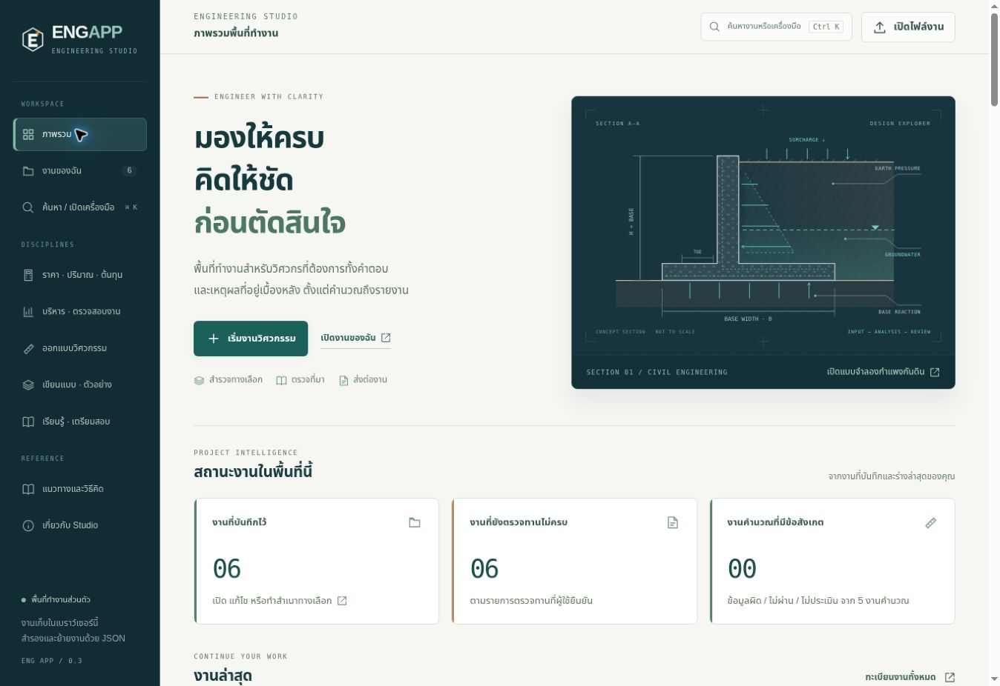
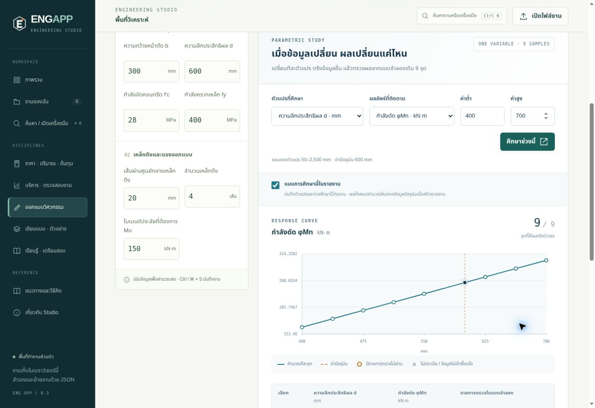

# Engineering Studio — version 0.3

Date: 21 November 2026 (Asia/Bangkok)

## Product intent

The user requested a workspace with the quality and credibility expected of an engineering consultancy. This release organizes the existing tools around project context, engineering alternatives, transparent methods and reviewable deliverables.

The public reference informed the initial catalog. This release adds an original interaction and visual system; it does not claim knowledge of the reference's authenticated functionality or accreditation by an engineering organization.

## Design and behavior

| Area | Delivered behavior | Reason |
| --- | --- | --- |
| Studio shell | Persistent desktop navigation; mobile navigation rail; cohesive ink/teal/paper palette; original section drawing | Make the application feel like one work environment across all 20 tools |
| Project overview | Real saved-project counts, current draft-aware previews, separate manual review and model-observation signals | Give engineers context without fabricated activity or a misleading global design-pass indicator |
| Calculator views | Results, A/current comparison, sensitivity and methods in four keyboard-accessible tabs | Keep decisions readable while retaining the detailed basis |
| Sensitivity | Nine actual model evaluations for one continuous input; selectable metric and custom range; explicit application | Explore parameter effects without silently changing the design |
| Portable study | Persist validated settings only; fresh calculation for reports; optional inclusion | Keep the study reproducible without trusting imported answers |
| Document control | Project code, client, location, preparer, named checker, revision, issue date, purpose, source notes and review records | Support a clear engineering handoff |
| Review integrity | Changed inputs/context clear prior confirmations but retain notes; names never imply approval | Keep human declarations distinct from calculated model checks |
| Technical report | Cover/title block, live model-check counts, pending review tasks, formulas, A/current comparison and optional study chart/table | Provide a document the next engineer can inspect |
| Fast navigation | Ctrl/Command K searches tools, saved projects and contextual actions; arrow/Enter interaction | Reduce navigation effort without removing visible controls |

## Numerical and review boundaries

- Existing engineering and quantity equations were not changed in this release. Their bounds, references and benchmarks remain in [engineering-models.md](engineering-models.md).
- Sensitivity uses the existing `definition.calculate` function for every point. Invalid or nonnumeric results remain explicit gaps, never zeros. A point with a failed model check remains labeled as such.
- Integer inputs and coupled price-index weights are excluded from independent continuous sweeps. The chart does not certify interpolated values or optimize the design.
- Saving stores input values and study settings, not calculated answers. Reports calculate the selected study again from current inputs and reject invalid included settings.
- Document purposes are draft and for review. The checklist is a user declaration, not a digital signature, issued approval or professional certification.
- Project data remains browser-local, with JSON portability. No server-based team permissions, live synchronization or production deployment is added.

## Verification evidence

- `npm run check`: passed.
- `npm test`: **113/113 passed**, including 12 sensitivity tests, 10 document-control tests and 2 dashboard-signal tests alongside all earlier regressions.
- Browser: all 20 tool routes loaded without an application alert under the studio shell.
- Browser: command search opened the beam calculator; all four analysis tabs remained available.
- Browser: a 300 mm wide, 4-D20 beam at d = 500 mm had φMn = 210.270603 kN·m. A 400–600 mm depth study returned nine points, including 165.031669 kN·m at 400 mm and 255.509538 kN·m at 600 mm. Explicit application of 600 mm changed only that field and A/current comparison showed +45.239 kN·m.
- Browser: after two human checklist confirmations, applying the study cleared them to 0/3 while retaining the document code/revision/context.
- Browser: custom depth bounds 400–700 mm and report inclusion survived save/refresh. Report contained one study with nine sample rows and the current document reference/revision/date.
- Browser: an included study with low = 800 and high = 700 blocked report generation and displayed the configuration error. The valid range was restored afterward.
- Browser: actual JSON download and reimport preserved project name, `DEMO-26 / STR-001`, revision P02, depth study 400–700 mm and report inclusion.
- Responsive: home and analysis at 390 px/768 px iframe sizes had no body horizontal overflow; table/tab overflow stays in its own container. Phone and tablet report covers also fit their viewports. The phone cover measured 311 px for both client and scroll width inside its 390 px viewport.

Native operating-system PDF/print dialogs were not automated. Screenshots show local test projects explicitly labeled as examples.

## Visual evidence

The feature remains on PR #2 for human review. CI and the exact delivered commit are linked in that PR.
