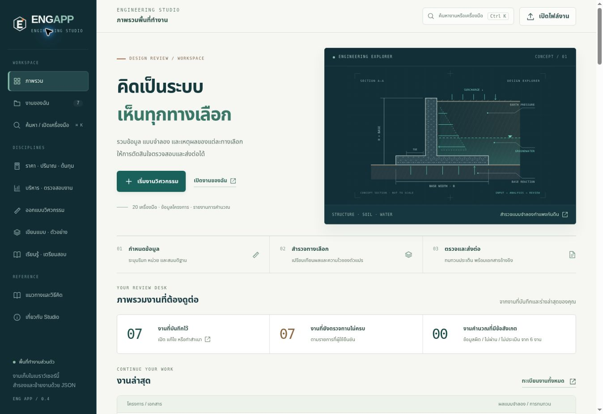
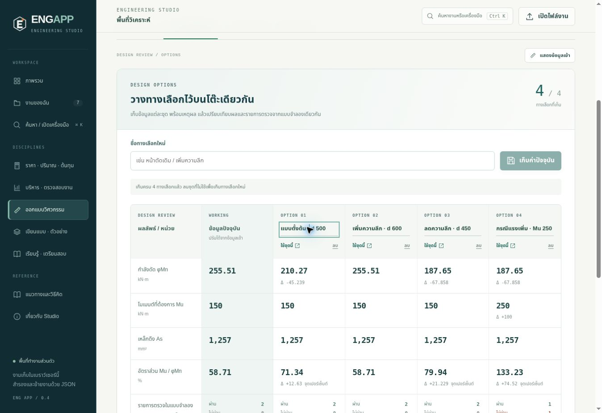
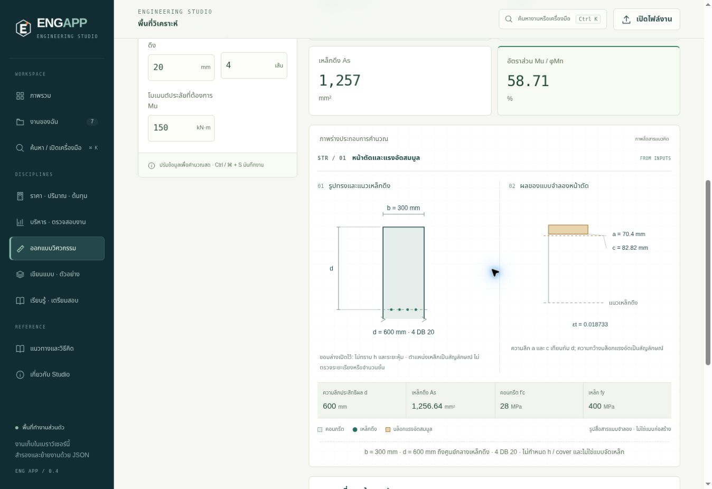
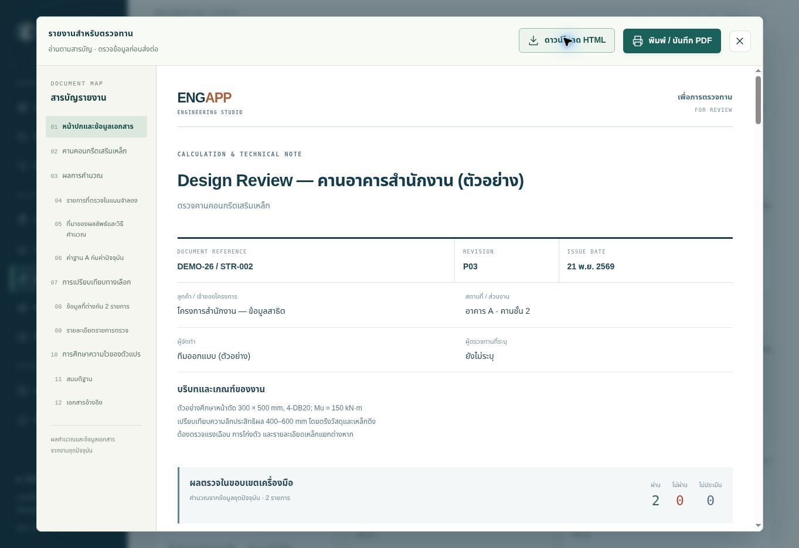

# Engineering Studio 0.4 — Design Review

Date: 21 November 2026 (Asia/Bangkok)

## Outcome

The next product refinement centers the workspace on reviewing design alternatives, inspecting the geometry behind a calculation, and handing a readable technical record to another person. The existing 20 tools, numerical model boundaries, project data and A/current comparison remain available. No numerical design equation was changed in this release.

## Product changes

### Named design alternatives

Each of the nine calculators can retain up to four named input snapshots, with a short plain-text note for each. The current draft and saved alternatives are recalculated through the same existing model, then compared by output label and unit. The matrix includes numeric deltas, literal pass/fail/unassessed counts, individual check details and changed input fields. Positive deltas do not imply a better design. There is no automatic ranking or engineering approval.

Capturing or inspecting alternatives leaves working inputs unchanged. Applying a named alternative explicitly replaces the defined input fields, retains document context and clears prior human review confirmations. Removal supports one-step undo. The wide comparison view hides the input panel temporarily; switching to another analysis tab restores it. First-column labels stay visible during horizontal table scrolling.

`data._options` stores schema version, tool ID, labels, notes, input snapshots and explicit report inclusion. It never stores trusted calculated answers. Imports validate scalar type, finite range, integer/select constraints and the model's coupled domain rules. Invalid, duplicate or excess entries produce an explicit notice, disable report inclusion and invalidate any previous human review confirmations. Valid state survives project JSON and refresh. Reports recalculate all included alternatives from their inputs.

### Technical drawings

Beam and slab figures respond to known dimensions, reinforcement inputs and returned calculation values. Effective depth is measured to the tensile-steel centroid. Total depth and cover are not inputs, so the lower boundary is left open and labeled rather than inventing a finished section. Bar positions are symbolic and do not establish spacing/detailing compliance. Slab symbols express repeated spacing, not a rounded count of bars used to calculate steel area.

The equivalent compression plot uses returned a, c and strain and is suppressed outside the supported flexure regime. Wall figures preserve the distinction between H above the base and water elevation from the footing underside; lateral and vertical heel surcharges are separately labeled. Footing figures mirror signed moment, partial contact and resultant direction. Unstable compression is not drawn as a centered, stable force. SVG definition IDs are unique between screen and report instances.

### Review brief and workspace

The home page has a compact two-line heading, technical-sheet framing, a three-step work sequence, an integrated project-status board and actual last-edited dates. Counts come from saved records and their matching drafts. Calculator review briefs identify actual failed checks before unassessed checks, show separate totals and distinguish them from human confirmations. Quantity-only outputs do not claim engineering acceptance.

### Readable, portable reports

The report preview has a section index on desktop and a section selector on small screens. Navigation does not change the application's route. Keyboard focus stays inside the modal, including when moving from a report heading. Wide tables scroll inside local containers, and long source URLs wrap without widening the report.

Download HTML produces a frozen report with embedded styles, inline SVG and any supported embedded images. No application scripts, external stylesheets or runtime account are required. An explicit content security policy blocks scripts and external resources. A failed stylesheet load blocks export instead of creating a partially styled file. The content and project identity are captured together before asynchronously loading styles. A changed design needs a newly generated report.

## Verification

Required local commands: `npm run check`, `npm test`, `npm run build`, `git diff --check`.

The test suite contains **143 passing tests**, including 14 design-option tests, eight technical-diagram tests, five report-export tests and five Studio tests, alongside the prior engineering, persistence, workflow and import regressions. Tests cover independent beam benchmarks, immutable snapshots, malformed/oversized imports, unassessed results, fresh reporting, escaping, signed pressure diagrams and offline-report packaging failure.

Observed browser checks:

- All 20 catalog routes opened with their expected heading and no application alert.
- Four beam alternatives were captured: d = 500, 600 and 450 mm with Mu = 150 kN·m, plus d = 450 mm with Mu = 250 kN·m. Current values remained unchanged by capture. Corresponding displayed capacities were 210.27, 255.51 and 187.65 kN·m; the increased-load option showed one failed check.
- At four alternatives the capture control was disabled. Remove/undo returned the collection from four to three to four. Explicit apply restored d = 600 mm and Mu = 150 kN·m.
- Save/refresh retained all four names, the first note, document code/revision and report-inclusion choice. Actual JSON download and file-picker import retained the same data.
- Applying an option reset two existing human confirmations to zero. Importing a deliberately malformed option retained the three valid alternatives, displayed the rejection, cleared report inclusion and reset previously marked confirmations.
- Reports included document reference `DEMO-26 / STR-002`, revision P03, the four-option matrix and optional nine-point study. Desktop section jumps and focus wrap from the final heading, final index control and cover worked inside the dialog.
- The HTML download contained embedded styles and diagrams, zero script tags, zero external stylesheet links, zero external media resources, no CSS imports, no duplicate IDs and the current values/revision.
- Phone 390 px and tablet 768 px home/analysis checks had no body overflow. Wide option tables remained inside their own scrolling area. The phone report preview had equal client and scroll width (337 px), while its cover was 309 px wide with no horizontal overflow. Mobile section navigation worked.
- Live slab geometry showed a 1,000 mm strip, d = 120 mm and DB10 @150; the beam and pressure drawings were checked alongside their declared dimensions and limits.

Verification limits: the cloud browser permits HTTP(S) navigation only and rejected opening the downloaded HTML through `file://`. The actual download and its complete static contents were verified, but opening the file directly in a local browser was not automated. Native operating-system print/PDF dialogs were not automated.

## Visual evidence

Screenshots contain explicitly labeled local demonstration projects.

## Scope and delivery

Use the existing issue #1, branch `codex/1-engineering-workbench` and PR #2. No merge or production deployment is part of this refinement. Browser-local storage, model bounds and human review declarations retain their documented meaning. See [engineering-models.md](engineering-models.md) for numerical assumptions and exclusions.
