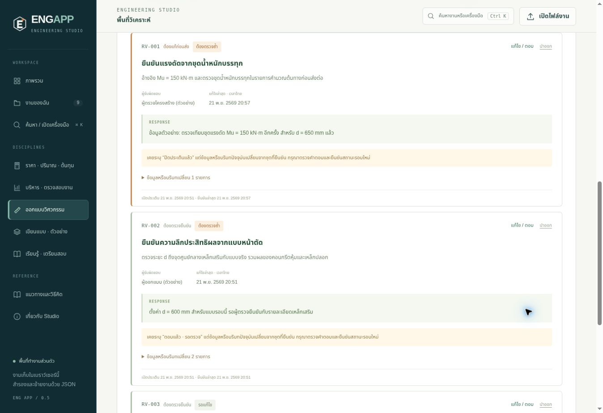
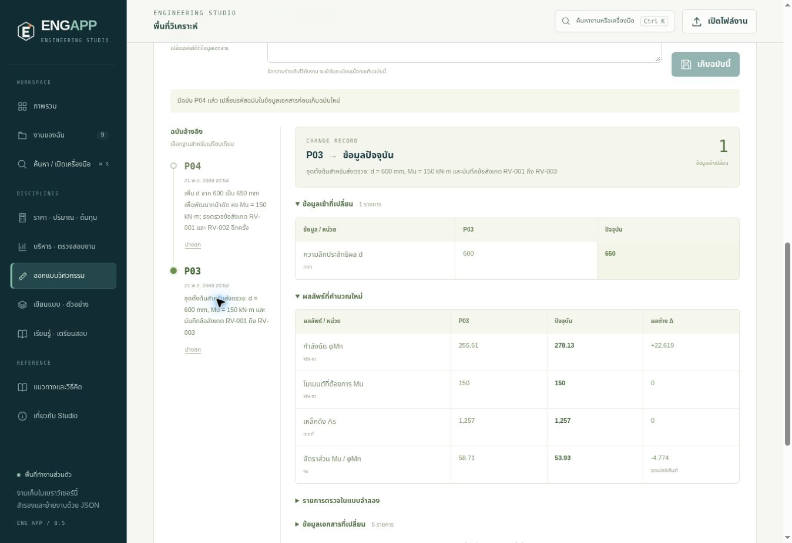
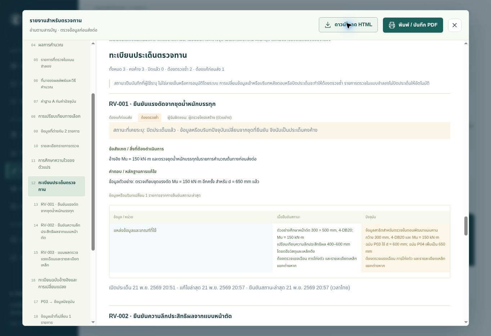
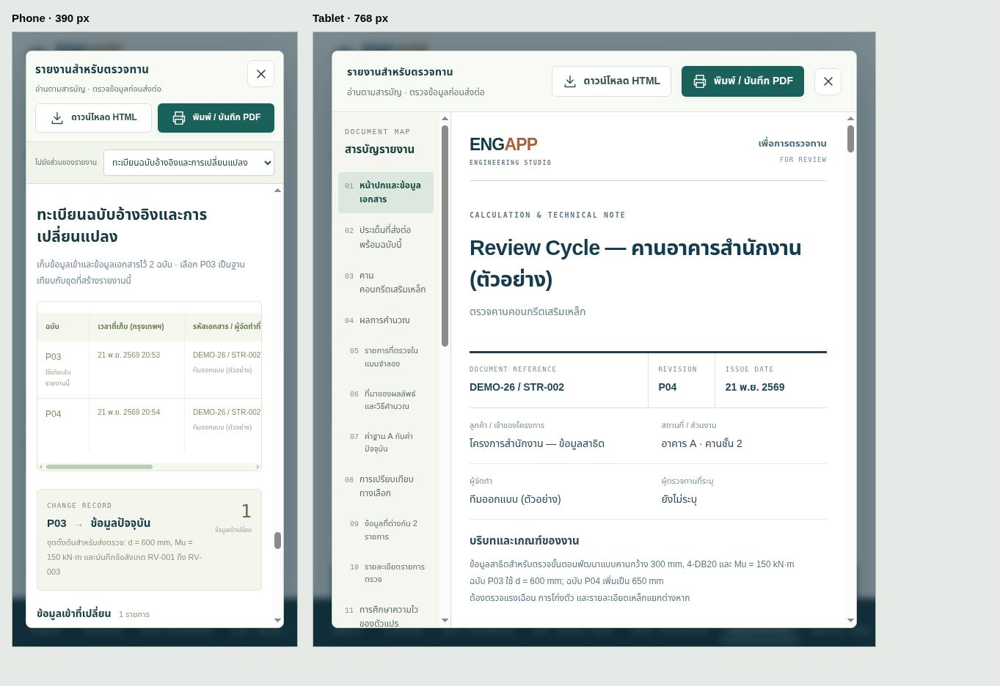
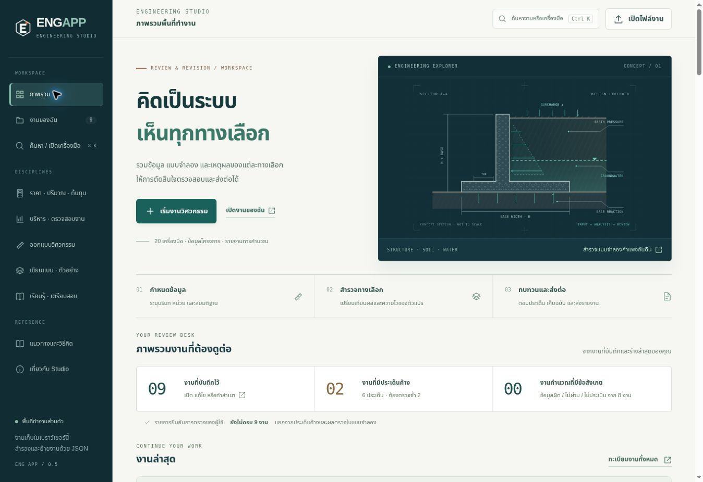

# Engineering Studio 0.5 — Review & Revision

Date: 21 November 2026 (Asia/Bangkok)

## Outcome

This refinement completes the local calculator review cycle: record an observation, explain the response, confirm its status against a particular input set and design context, then inspect what changed in the next calculation revision. The nine calculators share a new fifth analysis view, **ตรวจทาน**, with a full-width review register and revision comparison workspace. All 20 catalog tools and their existing numerical scope remain available. No engineering equation was changed.

The issue remains #1, the branch remains `codex/1-engineering-workbench`, and delivery remains PR #2. Merge and deployment are outside this refinement.

## Contextual review register

Each calculator supports up to 30 numbered observations. Records contain title, detail, owner text, priority, response, user-declared status, creation/update time, and independently copied input/context records. The three declared statuses are open, addressed and closed. Addressed and closed require a nonblank response and an explicit confirmation action. A passed numerical check never changes an observation's status.

The effective status is calculated from the current work. For addressed/closed records, different scalar inputs or a changed project code, client, site or design basis produce **ต้องตรวจซ้ำ**. This status counts as outstanding and preserves the earlier declaration and response. Revision labels, dates, names and checklist marks are excluded from this context comparison because ordinary document administration must not itself invalidate every response. Returning to exactly the confirmed inputs/context restores that matching status; the register is a contextual record, not a complete event log.

Search matches code, title, details, owner or response. Filters distinguish outstanding, open, addressed, closed and needs-review records. Removal has one-step undo. Monotonic sequence numbers avoid reusing accepted observation codes. Copying a project retains the reasoning but reopens terminal declarations for the new work.

`data._review` stores schema version, tool ID, next sequence, items and an optional pending editor draft. Current-model validation checks defined scalar fields, finite ranges, integer/select constraints and coupled domain rules. Timestamp validation requires canonical UTC calendar values. Imports bound text and collection size, reject duplicate/invalid records, disclose adjustments and invalidate prior document confirmations through the application wrapper. Derived answers, identity assertions and unknown executable markup are not trusted.

### Unconfirmed text remains recoverable

During QA, an unfinished response could have been omitted by the main project Save because only confirmed register records were serialized. The final implementation keeps a separate bounded `_review.pending` draft. Autosave, main Save, navigation cleanup and JSON export retain it. Reopening a project resumes the review page and restores the editor without committing its selected status.

Pending text never participates in issue counts or closes the saved item. Reports stop with a clear instruction to save the review item or cancel the draft, preventing the old response from being silently presented as the latest one. Clean existing editors and empty new forms do not block reporting. Explicit submission or cancellation clears the draft. The editor also prevents switching to another item or removing the current item while this would lose unfinished text.

## Calculation revision snapshots

`data._revisions` holds up to eight snapshots, a selected comparison reference, explicit report inclusion and a separate draft capture note. A snapshot records its ID, document revision code, required change explanation, capture time, validated inputs and normalized document metadata. Capturing does not alter live inputs. Existing snapshots cannot be edited through the UI; removal supports one-step undo. Duplicate revision codes are rejected case-insensitively.

Selecting a snapshot shows the changed input fields, freshly computed output deltas, model-check differences and document metadata changes, including changes to human declarations and notes. The snapshot stores inputs rather than trusted answers. Both sides of a comparison are recomputed using the current model; it does not reproduce an old software engine. Positive changes do not imply a better design. Percent-valued outputs use percentage-point differences.

Historical metadata that would be silently rewritten by normalization is rejected during import. This includes wrong types, missing known fields, invalid dates/purpose, malformed review rows, nonboolean declarations and overlong text. Remaining valid snapshots are retained, a notice explains the rejection, and report inclusion is cleared. A capture note that has not yet been issued is saved separately and restored on reopen, but is excluded from the report until a snapshot is captured.

Revision comparisons retain small nonzero differences instead of applying a relative tolerance that can erase genuine currency changes at large amounts. A regression using the actual weighted-index model at a 1e12 THB base amount preserves an approximately 0.1 THB difference and the accompanying tiny index change. This changes comparison presentation, not the model equations.

## Integration and reporting

The workspace shows actual outstanding, needs-review and revision counts. Nested tab navigation is scoped independently from the main calculator tabs and supports arrow/Home/End keys. Returning to inputs restores focus to the result tab. The home page and saved-project cards distinguish register issues, numerical observations and manual checklist declarations.

Register records are included automatically in calculator reports when present. A handover summary identifies outstanding and priority items before the calculation details. Each issue includes its response, recorded/effective status, changed context and dates. Revision history and the selected comparison are opt-in and identify the selected reference. Both sections appear in the report index and standalone HTML export. All 13 local stylesheet sources are embedded; no application script or external resource is needed in the exported report.

Import adjustments mark the project dirty even when it had no checked manual declarations, so rejected entries do not reappear from an otherwise clean saved record. Administrative revision selection/capture/report choices preserve current manual declarations. Changes to actual inputs, design context or registered review content invalidate relevant current declarations. Existing JSON files without these new module fields open normally.

## Verification

Required final gates: `npm run check`, `npm test`, `npm run build` and `git diff --check`.

The final suite contains **188 passing tests**, including 22 review-register tests, 20 revision tests and eight Studio tests. Coverage includes immutable contexts, evidence-required transitions, stale statuses, invalid live data, coupled calculator constraints, canonical dates, malformed/oversized imports, pending draft serialization, non-confirming pending closure, report blocking, copied-project reopening, fresh comparisons, metadata preservation, small financial deltas and output escaping. Earlier numerical/workflow/persistence regressions remain in the suite.

Observed browser checks:

- A demonstration beam retained three review records and two revisions. Blank closure evidence was blocked and focused the required response. Addressed items remained outstanding; explicit confirmation did not depend on numerical pass status.
- Capturing P03 at d = 600 mm retained three existing human checklist declarations and showed zero immediate input/document differences. Setting d = 650 mm cleared current declarations and made two answered/closed observations require review again.
- P03 retained d = 600 mm after P04 captured d = 650 mm. Selecting P03 showed capacity 255.51 → 278.13 kN·m and delta +22.619 kN·m with Mu fixed at 150 kN·m. The selected reference survived save/refresh.
- After reconfirming a response at the current depth, changing the design basis made it stale again. A project copy reopened all three saved observations while retaining their responses. The original remained separate.
- Status filters and record/revision remove-undo paths worked. Nested tab arrow keys changed only their own view, and returning to calculation inputs restored keyboard focus.
- A pending response with a selected closed status survived main Save and browser reload. The actual registered issue remained open. Report generation was blocked with an instruction to confirm or cancel. Cancellation restored ordinary reporting. A draft revision explanation also survived save/refresh without creating another snapshot.
- Actual JSON download and file-picker import retained the three observations, two revision inputs, P04 metadata and report inclusion. A deliberately malformed copy rejected one review item and one historical snapshot, disclosed the invalid selected reference, retained the valid records, cleared revision report inclusion and reset three previously marked declarations.
- The report index contained 23 sections for the demonstration project, including observations, responses, revision history and selected/current changes. The downloaded 285,940-byte HTML contained the new sections and embedded styles, zero script tags, zero external media/stylesheets, no CSS imports and no duplicate IDs.
- Phone and tablet layout checks used 390 px and 768 px iframe viewports. Body client/scroll widths matched at 373/373 and 751/751 px. Phone revision tables scrolled locally (299 px viewport / 450 px table). Report preview client/scroll widths matched at 335/335 px on phone and 537/537 px on tablet. Mobile report section navigation worked.
- All 20 catalog routes opened with their expected main heading and no top-level load error. The review view appeared on exactly the nine calculators.

Verification limits: native operating-system print/PDF dialogs were not automated. Direct `file://` navigation of downloaded reports remains unavailable in the cloud browser; the actual HTML download and its static packaging were inspected without bypassing that restriction. Mobile/tablet checks exercise responsive browser layouts, not physical devices.

## Visual evidence

Screenshots show explicitly labeled local demonstration projects and user-entered example roles.

## Practical boundaries

This is a browser-local workspace with portable project files. Owner names are plain text; they do not resolve accounts, notify colleagues or establish identity. Declarations and revision records are not signatures, approvals or tamper-proof audit history. The existing model limits in [engineering-models.md](engineering-models.md) still apply. Human review remains necessary for engineering decisions outside the explicitly implemented checks.
