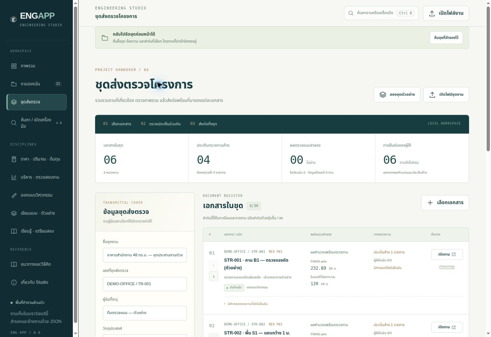
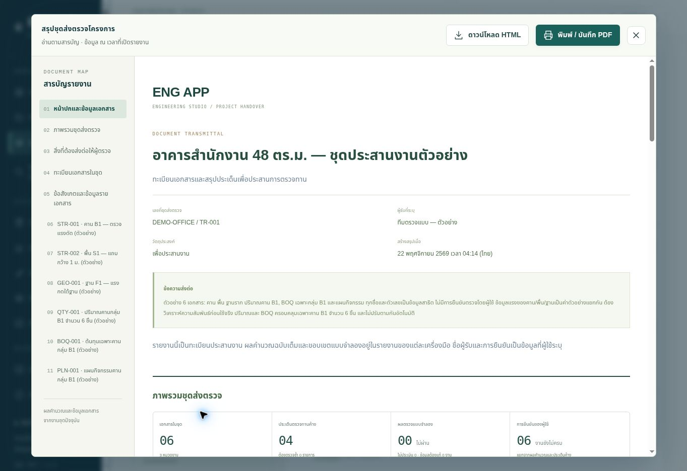
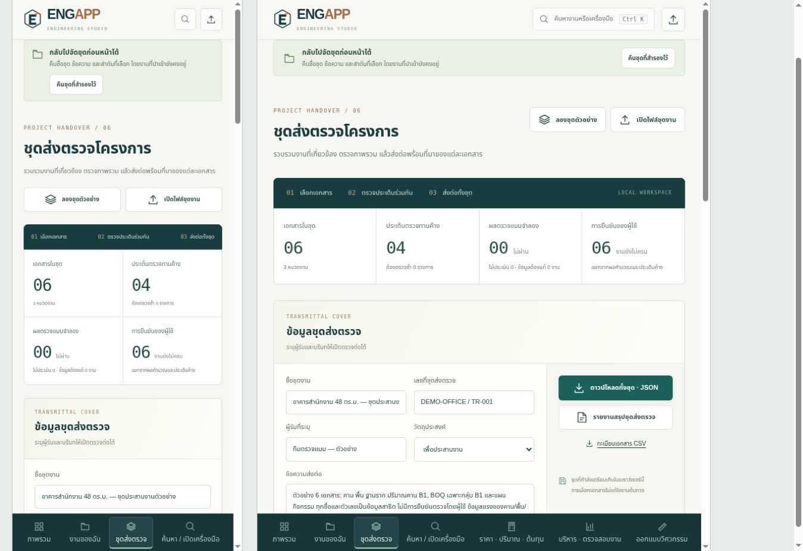
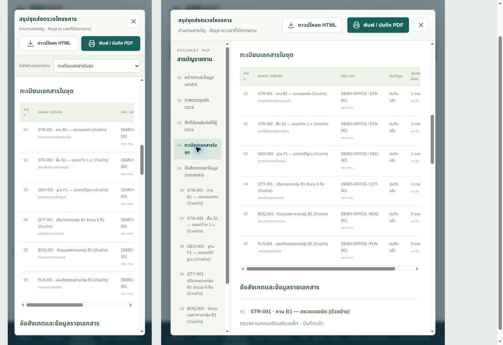

# Engineering Studio 0.6 — Project Handover

Date: 22 November 2026 (Asia/Bangkok)

## Outcome

This refinement adds an explicit multi-document review package around the existing engineering tools. A user can select saved calculation, quantity, cost and management records, put them in a chosen order, inspect their current observations, then carry the complete working data in one JSON file or prepare a coordination register for review.

The new **ชุดส่งตรวจโครงการ** workspace is available from the main navigation, home page, project register and command palette. All 20 tools retain their existing scope. No engineering equation changed. Delivery continues through issue #1, branch `codex/1-engineering-workbench` and PR #2.

## Explicit membership and a recoverable cover

A package contains up to **30 selected records**. Membership is explicit: the application does not split or infer project relationships from the existing combined project/document code. This matters because two documents in the same project can have different codes, while two unrelated jobs can contain similar text.

The composer holds a title, transmittal reference, recipient text, purpose and handover note. Search narrows the available source records; selecting the displayed results applies only to that filtered set. Users can reorder the selected records, remove a member and undo the most recent removal. Removing a member does not delete its source job. A deleted or otherwise missing source remains visible in its numbered position until the user resolves it; JSON export refuses to silently omit it.

Cover text and ordered selection are persisted as the current browser-local handover draft. Importing another package or creating the example replaces that composer after a preview explains the replacement. One previous composer is kept as a backup. Restoring it returns its cover and selection while retaining all imported source jobs; it does not roll back source inputs. Storage errors are surfaced, including the distinction between successful job import and a composer or backup that could not be persisted.

This is one working composer with one previous backup, not a server document-management system or an unlimited saved-package archive. Exported JSON files are the portable package records.

## A register based on the actual source state

The package resolves each selected saved record through the existing project-specific draft rules. A valid newer draft is used and marked as such. A draft from an incompatible saved base does not silently replace the current saved record. Opening a source or preparing an export re-reads local saved work; storage events refresh the open handover when another tab changes saved records or drafts.

The register keeps several different findings visible:

- Numerical failures and unassessed checks from the supported calculation model.
- Outstanding review-register observations and observations that require review again.
- Documents whose user-entered review declarations remain incomplete.
- Pending review-response text or an unfinished revision note.
- Site-inspection defects, when an inspection document is selected.
- Missing sources, invalid current inputs and imported metadata that needs attention.

Calculator metrics are freshly evaluated from strictly validated recorded inputs. Missing numeric fields and numeric strings do not become successful calculations through default substitution. Workflow summaries likewise require complete supported state; if opening a workflow would repair or default its data, the handover explains the issue and withholds a misleading total. Special reference tools receive a reference label rather than an invented engineering assessment.

BOQ values remain individual document totals. Price-book rows are unit-price records, not an estimate. The package does not sum potentially overlapping BOQs, compare unrelated engineering quantities or generate a global approval percentage. Its displayed review findings do not mutate source inputs, historical observations or user declarations.

## Portable bundle and append-only import

The bundle envelope uses `format: "engapp-project-bundle"` and `schemaVersion: 1`. It contains the package metadata, export timestamp, app version and ordered records. Each record includes a source ID, saved/draft provenance, tool ID, name, timestamps and its complete data payload. Design alternatives, sensitivity settings, historical revisions, review observations, pending response text and document metadata remain inside that payload.

Packages are limited to **8 MB and 30 records**. Validation checks the envelope, recognized tools, unique source identities, canonical timestamps, complete bounded metadata and JSON structure before import planning. Excessive nesting, collection sizes, unsafe keys, non-JSON values and oversized packages are rejected. These checks validate transport and supported structure; they do not certify the engineering content.

Recoverable invalid calculation inputs can still travel in a bundle. The preview exposes the relevant findings, and the original payload remains available for correction in its source tool. The importer does not silently convert an invalid value into a passing result. Existing single-record JSON files continue to use their original opening workflow.

Confirmation creates fresh local IDs for every imported record. Source IDs are not overwrite targets. The import planner receives the latest saved-project list, preserves that list and appends the complete batch through one project-storage write. If that write fails, existing stored jobs remain intact. Existing tool drafts and their pointers are not cleared. Package metadata is saved separately after the job batch, with a separate message if that step fails.

Import is a portable continuation of the recorded work. Valid payloads and user-entered declarations are preserved, subject to the existing source-tool validation when opened. This differs from the application's explicit **ทำสำเนา** action, which starts a new review cycle. Neither path establishes identity or engineering approval.

## Three handover outputs

| Output | Contents and purpose |
| --- | --- |
| Bundle JSON | Complete selected working records, cover metadata and their order; suitable for continuing work in another browser. |
| Register CSV | Ordered document identities, revisions, source state and distinct model/review findings; uses the existing spreadsheet-safe CSV escaping. |
| Coordination report | Cover, package overview, numbered document register and per-document metrics, declared design basis and warnings. |

The coordination report is a transmittal summary. Full calculations, detailed responses and model-specific report content remain available in the individual tools. The report identifies this scope on its cover.

Opening a report captures its rendered content. The preview, standalone HTML download and print preparation use that same captured report, even if a source changes while the preview is open. Closing and reopening creates a new snapshot. Ctrl/⌘+P in an open report prints the captured report; it does not replace an import preview with an unrelated calculation report.

Standalone HTML reuses the existing indexed report reader and embeds the local styles, including the handover stylesheet. It requires no application script or recalculation to read. Recipients and handover notes are plain text; creating or exporting a package does not send a message, grant access or notify another person.

## An authored six-document example

The **ลองชุดตัวอย่าง** action previews six new records before adding them. The setting is an illustrative 6 × 8 m office, identified throughout as sample data. It demonstrates document coordination, not a complete building design.

| Document | Example scope |
| --- | --- |
| STR-001 — Beam B1 | Width 300 mm, effective depth 550 mm, 4-DB20 and an independently entered illustrative Mu of 95 kN·m. |
| STR-002 — Slab S1 | One-metre strip, effective depth 120 mm, DB10 at 150 mm spacing and illustrative Mu of 12 kN·m/m. |
| GEO-001 — Footing F1 | 2 × 2 m footing; illustrative service N = 450 kN, M = 60 kN·m and gross allowable pressure = 200 kPa. |
| QTY-001 — B1 beam group | Six 4 m beams with 0.30 × 0.60 m gross sections: 4.32 m³ concrete, 36 m² formwork and 518.4 kg reinforcement estimated by a stated rate. |
| BOQ-001 — B1 beam group only | A one-time quantity snapshot with sample material/labour rates. Direct cost 47,376 THB; total 55,761.55 THB with the stated sample 10% overhead and 7% VAT inputs. |
| PLN-001 — B1 activities | Seven activities over 30 calendar days, 1–30 December 2026, with simulated progress assessed on 8 December. Zero activity budgets deliberately use duration weighting. |

The BOQ covers only the B1 beam group. It is not the price of the office building. It does not update automatically when the quantity record changes. The reinforcement allowance is an estimating rate, not a BBS derived from the flexural record. Beam, slab and footing actions are independent illustrative inputs; the application does not derive or connect their load paths. Allowable soil pressure is sample data, not a soil-investigation result.

Four calculator records start with open observations covering omitted checks and data that must be confirmed. All six documents have unchecked human declarations and no named reviewer. The example generator writes no storage itself and returns fresh independent records for the ordinary preview/import path.

## Verification recorded for this refinement

Local gates passed: `npm run check`, `npm test`, `npm run build` and diff checks. The full suite contains **221 passing tests**, including 20 handover-core tests, six coordination-report tests and seven example-package tests, alongside the 188 earlier regressions.

Focused coverage includes strict current inputs, explicit missing members, draft provenance, separate model/review/manual findings, workflow default detection, unchanged source data, complete bundle payloads, malformed and oversized envelopes, bounded structures, ID collisions, failed project writes, preservation of another tab's newer saved record, spreadsheet escaping, report escaping and example quantities/schedule.

Observed browser evidence includes an actual six-document example export followed by file-picker import. All six record data payloads and the package cover metadata matched exactly after the round trip. Imported records received new IDs rather than reusing the six source IDs. The nine pre-existing jobs remained present: creating the six-record example and importing its six copies produced **21 saved jobs**. This verification checks real download/import behavior, in addition to the pure data tests.

Additional observed browser checks:

- Cancelling the example preview and reloading retained the previous one-document package, its title and transmittal reference. Importing the example created six jobs; the restore control swapped between the previous one-document composer and the new six-document composer without changing the 15 saved source jobs.
- Reorder, remove and one-step undo preserved the selected set. Typing into the recipient field kept focus and the complete entered text. The `/` shortcut opened the collapsed source picker and focused search.
- An unsaved beam change from Mu = 95 to 120 kN·m appeared as a current draft in the register and actual JSON export. A response with a pending selected status of closed travelled intact while the confirmed observation remained open.
- The report was opened at Mu = 120 kN·m. A second tab changed and saved the original beam at Mu = 140 kN·m. The already-open report and its downloaded HTML still contained 120, while the handover workspace showed 140 after the report closed. Importing the earlier bundle created a separate 120 copy and preserved the original 140 job.
- The actual 282,966-byte report download contained 11 indexed sections, no script elements, no external media or stylesheets, no CSS imports and no duplicate IDs. All 14 local stylesheet sources were included by the exporter. The actual CSV contained six ordered document rows and the entered recipient metadata.
- A deliberately malformed bundle with duplicate source IDs was rejected before opening the import preview. The saved count remained 21.
- All 20 existing catalog routes opened with their expected main headings. This route smoke check supplements the existing numerical and workflow regression suite.
- Responsive checks used 390 px phone and 768 px tablet iframe viewports. Workspace client and scroll widths matched at 375/375 and 753/753 px. The phone search narrowed the picker from 21 jobs to one; selecting the displayed result changed membership from six to seven, and unchecking it restored six. Keyboard reordering moved the beam while preserving focus on its reorder control.
- Report preview client and scroll widths matched at 337/337 px on phone and 539/539 px on tablet. The phone section selector and tablet index navigated to the document register. Wide register tables scrolled within their own containers without widening the page.

Native operating-system print/PDF dialogs were not automated, and responsive iframe checks do not represent testing on physical devices. The actual HTML download was statically inspected; no direct `file://` browser run was performed for this release. Published-commit CI status is recorded in PR #2.

## Visual evidence

These screenshots show the real application with explicitly labelled example data after the browser workflow checks.

## Practical boundaries

The workspace remains browser-local. There are no team accounts, automatic notifications, shared database, signatures or tamper-proof event history. A handover package organizes records selected by the user; it does not prove that those records describe a consistent engineering design. Numerical and workflow limits remain those stated in [engineering-models.md](engineering-models.md) and the source tools. Package-level totals are counts, while costs and physical quantities stay within their respective documents.
