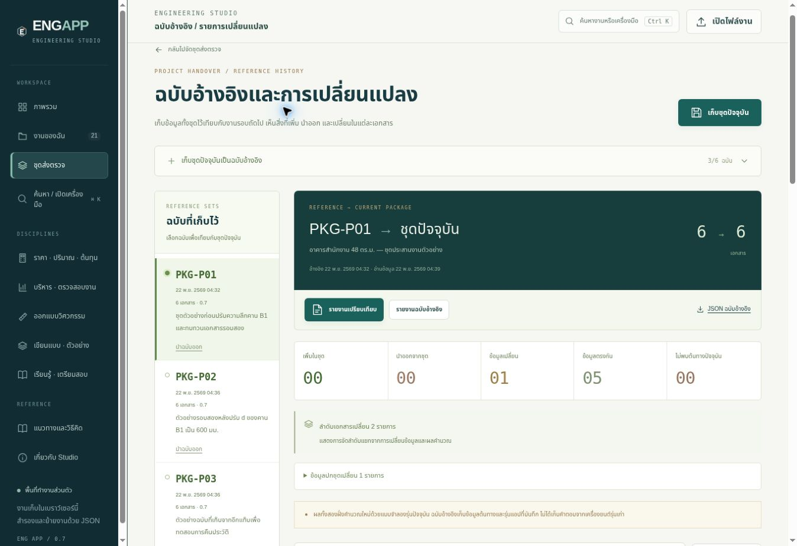
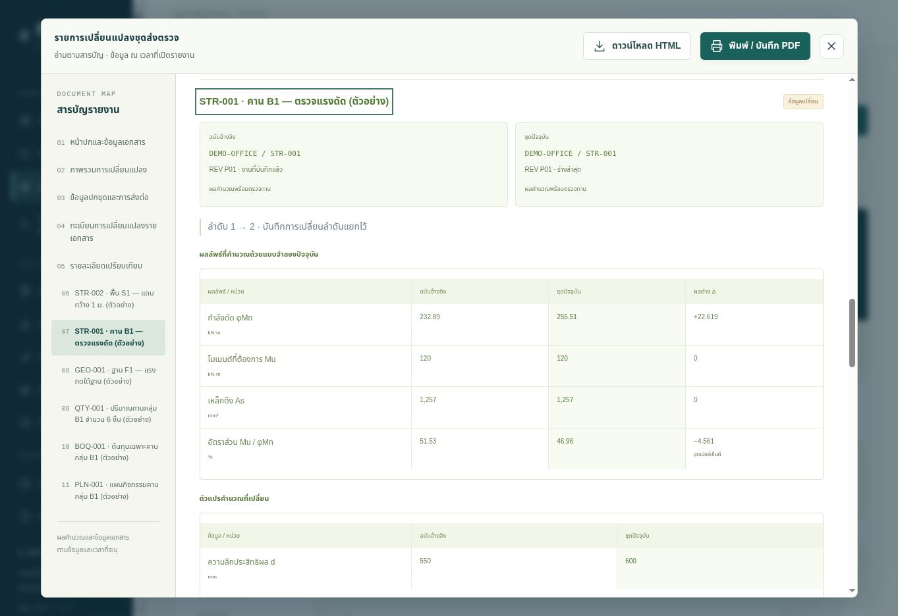
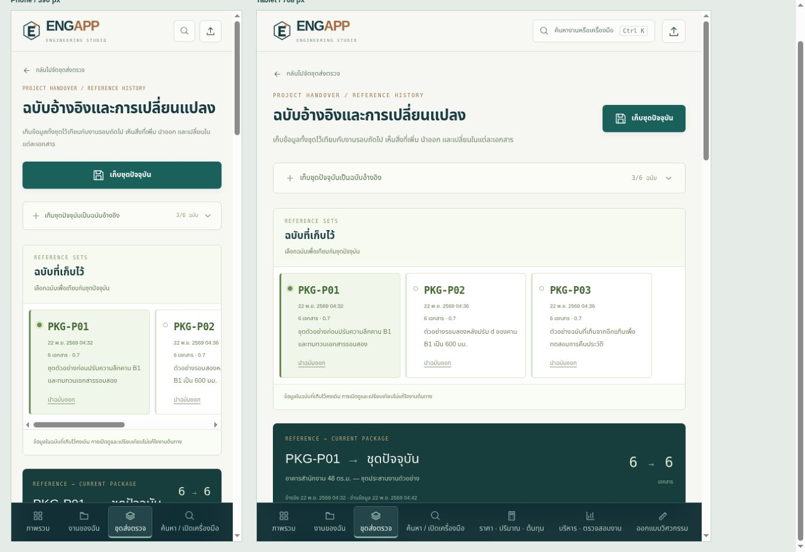
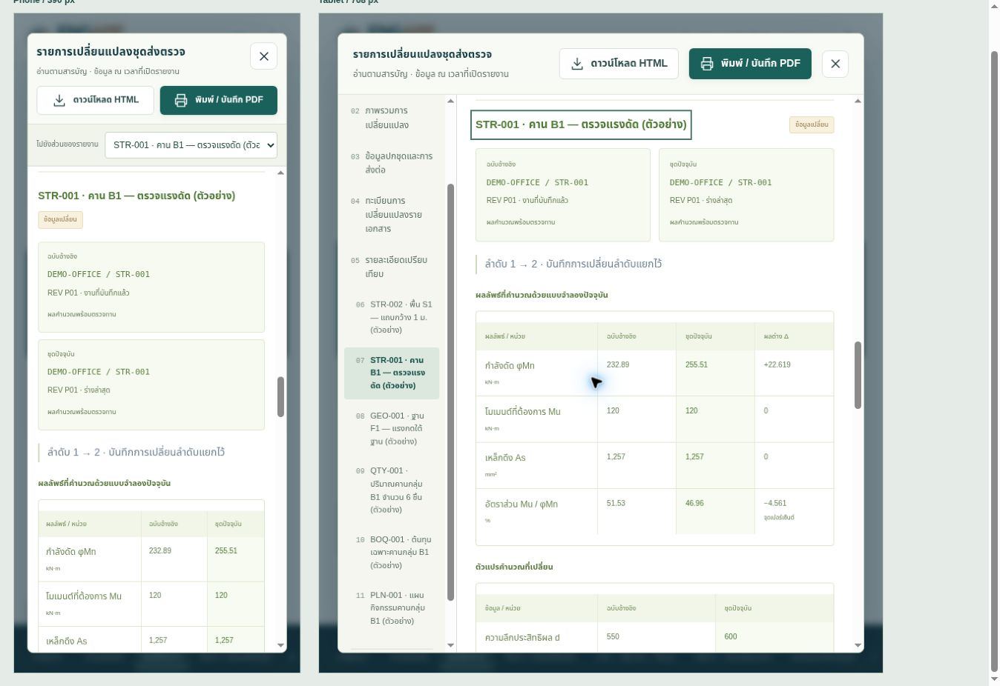

# Engineering Studio 0.7 — ฉบับอ้างอิงและการเปลี่ยนแปลง

Date: 22 November 2026 (Asia/Bangkok)

## Outcome

The handover workspace can now retain a complete package as a named reference and explain how the current selected package differs from it. This extends the multi-document workflow introduced in 0.6: prepare a package, capture its source data for a review round, develop the underlying work, then inspect additions, removals, changed inputs, current calculation differences and document-control changes.

The new **ฉบับอ้างอิงและการเปลี่ยนแปลง** workspace is available through navigation and command search. Existing tools, numerical equations, project IDs and draft-resolution rules are preserved. Delivery continues through issue #1, branch `codex/1-engineering-workbench` and PR #2.

## What a reference captures

The browser-local evidence archive supports **six references** with a combined serialized limit of **4 MiB**. Capturing requires a reference code and a reason or note. Codes are unique case-insensitively. The form supports a code of up to 40 characters and a note of up to 1,200 characters; its unfinished text is retained separately from the evidence archive.

Each reference records an immutable package bundle, its reference ID, code, note, capture timestamp and app version. The bundle contains the selected documents in their captured order, their complete data payloads, cover metadata and saved/draft provenance. This includes review observations, unfinished response text, design alternatives, calculator revisions and other supported source data.

The snapshot copies the actual source data; it does not hold live references that change when the original project changes. Viewing, comparing, exporting or removing a reference does not alter source inputs, saved jobs, review declarations or draft pointers. There is no interface for editing an existing captured reference. A new review round uses a new reference code.

The existing package transport limits still apply. Capture refuses missing or ambiguous selected sources and malformed package structure. A structurally valid package can contain a calculation that needs correction; capturing it does not turn those inputs into a successful calculation. Invalid records remain visible as such in the derived register.

The 4 MiB archive limit is an application bound, not a guarantee of free browser quota. Saved jobs, images and other browser data also consume storage. An actual storage failure leaves the previous archive intact and keeps the capture text available for retry or JSON backup.

## How changes are identified

Matching uses the exact internal source-record identity. Names, document codes, tool titles and similar values are not used to guess relationships. A package imported as new jobs receives new IDs, so comparing it with a reference from the original jobs shows added and removed records. If a record with the same ID changes its tool type, the change is disclosed and numerical results are not compared across different models.

The change register distinguishes:

| Status or change | Meaning |
| --- | --- |
| Added | A selected current record was not in the captured package. |
| Removed | A captured record is no longer selected in the current package. |
| Changed | A matched record has changed name, tool, data, provenance or other substantive recorded state. |
| Unchanged | The matched record has no substantive recorded change. |
| Missing | A currently selected source cannot be resolved; this is shown separately from an intentional removal. |
| Order change | The relative order of shared records changed; this is tracked independently from their calculation data. |
| Cover change | The package title, reference, recipient, purpose or handover note differs. |

For calculator documents, detail rows identify changed input values and units. Document comparisons cover the recorded metadata, individual human declarations and their notes. Other state changes, including BOQ rows, schedule tasks, review registers and design alternatives, are identified by section with counts of changed entries or fields. This is a bounded review summary, not a complete line-by-line audit of every nested object or image. The exact payload remains in the exported reference bundle.

Numerical differences use fresh calculations on both sets of recorded inputs. Invalid or unavailable values do not produce a fabricated delta. Percentage-valued results use percentage-point differences. Small nonzero differences retain enough precision to remain visible. Re-saving a source with only a new `updatedAt` timestamp does not by itself classify the design as changed; the timestamp difference remains available as context. A saved/draft provenance change is recorded explicitly.

Missing, invalid and unassessed conditions are separate. A missing source has no current record to calculate. An invalid source has data that cannot produce a supported current result. An unassessed check is a result explicitly outside a particular model's evaluation. None of these states is equivalent to a passing engineering check.

## Current work and historical evidence

The current side uses the existing project-specific resolution rules: a valid newer draft for the same saved record can be compared and is labeled as a draft. A stale draft from an incompatible saved base does not silently replace the latest saved project. The captured side always uses its stored bundle, even if its original local jobs are later edited or deleted.

The comparison re-reads the current composer and saved/draft records. Changes from another tab refresh the visible register while preserving unfinished capture text. A selected reference that has disappeared is disclosed; the interface does not silently choose a different reference.

The selected reference and unfinished code/note are small UI preferences stored separately from immutable evidence. Inspecting a reference therefore does not rewrite its bundle. The existing current-composer backup from 0.6 remains separate from this package-reference history: restoring a composer changes which documents are selected, while an archived reference retains its captured data.

## Storage, concurrency and remove/undo

Capture, removal and undo acquire the same origin-scoped **Web Lock** used by cooperating tabs. The transformation runs synchronously against the latest validated archive after the lock is acquired. One `localStorage.setItem` writes the complete next evidence state. Selection, capture-form clearing, success messages and undo state change only after that write succeeds.

This prevents one cooperating tab from committing an archive assembled before another tab's capture. A browser without the required lock capability receives an explanation and can still use ordinary package JSON exports. The lock coordinates this application's tabs; it is not server synchronization or protection against arbitrary external modification of browser storage.

Removing a reference leaves the source projects in place and creates a one-step undo. Undo reads the latest archive and reinserts only the removed reference, retaining references captured from other tabs. It checks the current capacity and identity/code collisions and does not replace an existing reference. It never restores an old whole-history array over newer work.

Reading history does not repair it in place. Invalid entries or settings are disclosed, and valid readable entries remain available for inspection/export. If the archive is malformed or would require adjustment, mutations are blocked so a later capture cannot silently overwrite the unreadable evidence. Strict validation includes the reference envelope, timestamps, bundle identity, matching app version and byte/collection limits.

## Reports and historical JSON

There are two new report contexts:

- **Reference report:** the captured package's cover, document register and per-document observations, labeled with its reference code, reason, capture time and app version.
- **Comparison report:** package-level change counts, cover changes, ordered document status and the available per-document input, metadata, section and result differences.

Both reports use the existing indexed reader. Opening a report captures its rendered content; preview, standalone HTML download and print preparation use that same content while it remains open. Changes to the live source or archive do not rewrite the opened report. Reopening produces a fresh report. History keyboard printing selects the history comparison context, and Ctrl/⌘+P inside an open report uses its captured content.

**Historical numerical outputs are recomputed with the current engine.** The archive preserves input data and the app version recorded at capture. It does not retain or execute an old engine. Both screen and report explain this distinction; a reference report is not a replay of the numerical software that existed at capture time.

The **JSON ฉบับอ้างอิง** action downloads the complete original package bundle. It works from the captured evidence rather than from today's source jobs. This is the ordinary portable package format: opening it imports new working jobs through the established preview and append-only path. It does not automatically restore an archive entry or reuse its original local source IDs. Reference code and capture reason are shown in the archive/reports; the exported bundle retains the package's original cover metadata.

## Verification

The full local suite passed **256/256 tests**, including **21 history-core tests**, **six history-storage tests** and **eight history report/UI tests** added in this refinement. These cover immutable captured inputs, strict envelopes, bounded history, case-insensitive codes, exact identity comparisons, raw input/document/section differences, invalid and missing records, timestamp-only changes, output precision, storage failures, simultaneous serialized capture, merge-safe undo, escaping and report context. The 221 earlier numerical, workflow, persistence and handover regressions remain in the suite.

Observed browser checks:

- The first reference of a six-document package compared as six unchanged records immediately after capture.
- A blank required capture field was blocked before creating a reference.
- Unfinished reference code/note survived a browser reload without creating another capture.
- A duplicate reference code with different letter casing was rejected while preserving the form and existing archive.
- Editing the beam's effective depth from **550 to 600 mm** without pressing the main project Save appeared as a current draft and produced **one changed / five unchanged** documents. The comparison showed capacity **232.89 → 255.51 kN·m**, a difference of **+22.619 kN·m**, while the QA case's entered **Mu remained 120 kN·m**. The reference retained its earlier source values.
- Actual snapshot JSON downloads before and after that unsaved beam edit were byte-for-byte identical: **33,680 bytes**, with SHA-256 **`869bf8bd4d48a9bfc79dd47d3c7724c9cd28529aa03a94dd8baae420049eacbc`**. This checks the exported historical payload, rather than only a displayed earlier input.
- Captures made from two browser tabs both remained in the archive. Unfinished capture text in the main tab survived the other tab's activity. Removing the currently selected reference produced the missing-selection notice instead of switching silently. Undo restored a removed reference while retaining a further reference added from the other tab.
- A temporary membership/order/cover exercise produced **one added, one removed, one changed and four unchanged** documents, **two reordered** entries and **one cover change**. The original six source documents were reselected afterward.
- The downloaded comparison HTML was **307,510 bytes** and contained **11 indexed sections**. Static inspection found **zero script tags, external resource URLs, CSS imports or duplicate IDs**.
- Phone and tablet review used **390 px and 768 px iframes** in a real browser. The history workspace had matching client/scroll widths of **375/375 px** and **753/753 px** after the browser scrollbar. The phone's wide comparison tables scrolled inside labeled, keyboard-focusable regions; the ArrowRight key moved the table horizontally without widening the page.
- The changed-document filter and Thai search returned the beam as **one of six** records. Clearing filters restored all six. The phone report's section selector and tablet report's contents buttons navigated to the beam comparison. Their report panes had matching client/scroll widths of **337/337 px** and **539/539 px**.
- All **20 existing catalog routes** loaded their expected tool heading after the new route was integrated. Returning to reference history retained the six-document package and three captured references.

An independent module-level check used the authored six-document example, stored a reference through the history-storage module, and repeated the depth change. Source data, the captured entry and persisted archive remained unchanged. Re-importing the package with fresh IDs correctly produced six added and six removed records rather than inferred matches.

Validation commands are `npm run check`, `npm test` and `npm run build`. Published-commit CI evidence is recorded on [PR #2](https://github.com/saratchai1/eng-app/pull/2). Native operating-system print/PDF dialogs and physical mobile devices were not automated; the responsive evidence above is from controlled browser iframes.

## Visual evidence

The screenshots show the local QA package and explicitly labeled example source documents.

## Practical boundaries

Capturing a reference does not send a package, approve a design, verify a person's identity or create a digital signature. The archive is browser-local and is not a tamper-proof audit log. Codes, reasons and review declarations are user-entered records. Source tools retain their documented engineering and workflow limits; package change review does not establish load continuity, reconcile BOQ scope or certify that all disciplines form a consistent final design.
