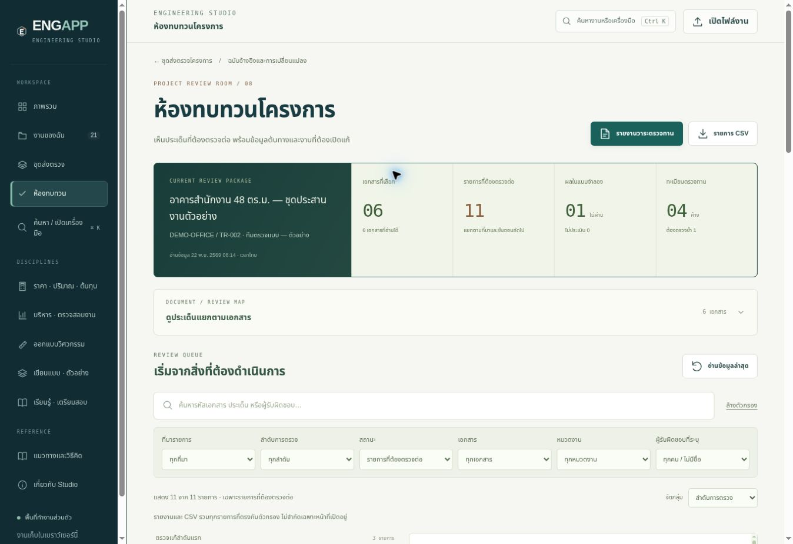
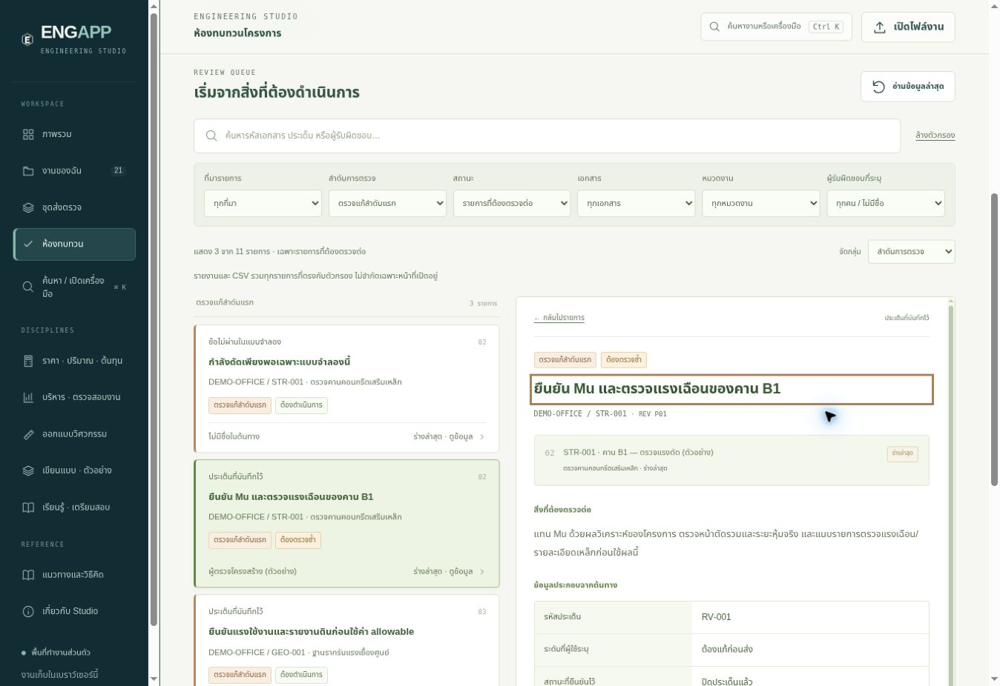
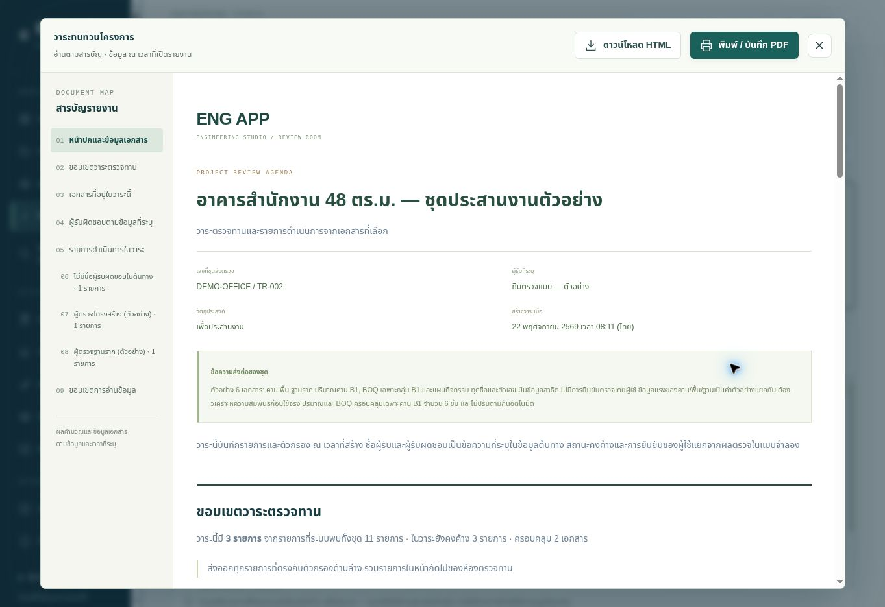
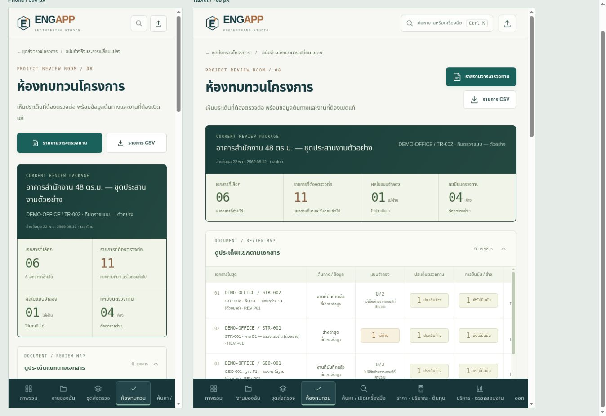
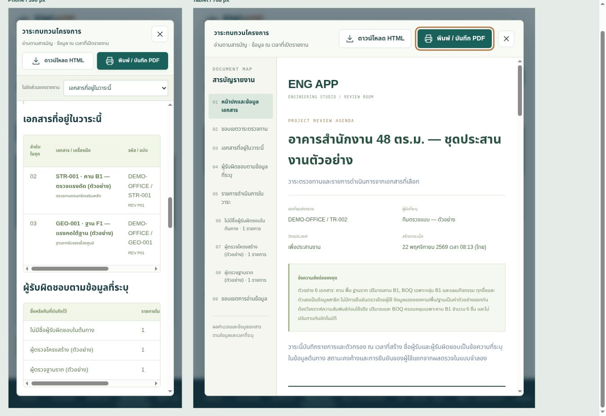

# Engineering Studio 0.8 — Project Review Room

Date: 22 November 2026 (Asia/Bangkok)

## Outcome

The new **ห้องทบทวนโครงการ** turns the current handover package into a working review agenda. A reviewer can see which selected documents need attention, inspect the recorded evidence, open the exact source job at the relevant section, then return to an updated queue. The room is available from the home page, package workspace and command search.

This builds on the explicit package composer in 0.6 and captured package references in 0.7. The room reads the current selected sources; it is not another editable issue database. Existing model equations, authored review items, document declarations and package reference data remain their respective sources of truth. Opening or filtering the room does not close issues, check declarations or change source inputs.

## The current package is the scope

Membership comes from the existing ordered handover selection, which supports up to 30 source documents. The room does not infer relationships from similar project names, document codes or tool types. Source resolution uses the exact internal project identity. Missing sources and multiple saved records with the same identity remain explicit conditions that require attention.

The current side uses the existing project-specific saved/draft rules. A valid newer draft for the selected job is included and labeled **ร่างล่าสุด**. A draft for another job using the same calculator is not substituted. The source badge and warnings explain unfinished source work without inventing a duplicate failure simply because a job has a draft.

Every rebuild recalculates supported tools with the current model definitions. Calculator validation, coupled model limits and workflow validation remain in the existing modules. Malformed BOQ, planning or inspection data is not normalized into an apparently valid default result. Reference-only tools retain their actual lack of model assessment.

## Counts describe different facts

The briefing separates selected documents, derived items requiring follow-up, model failures/unassessed checks and outstanding authored review items. These numbers have different meanings. A single source document can contribute several model observations, an authored review item and one grouped document-preparation item.

The room does not calculate a completion percentage, project safety score or approval status. An empty queue means that no matching follow-up items were derived under the displayed scope; it does not mean that every engineering check exists or that a person has reviewed or approved the design. An empty package has its own action to choose documents.

The derived finding types are:

| Type | Evidence and behavior |
| --- | --- |
| Missing/ambiguous source | The selected local record cannot be resolved uniquely. The next action returns to package membership. |
| Invalid current data | The current calculator or workflow cannot produce a supported result. The original error/context remains visible. |
| Data requiring restoration review | Invalid or adjusted document metadata, review records, revisions or design alternatives are disclosed. Reading the room does not rewrite the source. |
| Failed model check | The actual failed check label and detail are shown. This is a result within that tool's stated scope. |
| Unassessed model check | The actual unassessed condition remains separate from failed or passing checks. No numerical zero is invented. |
| Authored review item | The recorded title, detail, response, priority and owner are shown with the effective current status. |
| Document preparation | One grouped item per document lists pending human declarations and missing handover context. |
| Pending editor text | An unfinished review response/new issue or revision note remains explicitly unconfirmed. |
| Recorded inspection defect | A valid inspection workflow's failed row retains its actual title, group and note. It does not become a structural calculation failure. |
| Pending inspection | Uninspected rows are grouped with their original titles; they are not treated as passing or not applicable. |

The grouped document item identifies absent project/document code, author, recorded checker, document date and design basis alongside the three existing human declarations. These are transparent preparation prompts. They are not a new certification standard or a claim that entering a person's name verifies their identity.

## Working order and recorded responsibility

The three action groups are **ตรวจแก้ลำดับแรก**, **ตรวจและตอบประเด็น** and **เตรียมข้อมูลส่งต่อ**. They provide a practical working order. Missing/invalid sources, model failures, recorded inspection defects and authored critical issues appear in the first group; other review observations and unassessed conditions appear in the second; document preparation and unfinished editor text appear in the third. The user's original issue priority is retained separately.

Within the derived order, outstanding items precede closed items, followed by action group and package document order. The screen can regroup matching items by action group, source document or recorded owner. Grouping changes presentation only.

Owner groups use the literal normalized owner text on confirmed review items. Different strings are not merged through fuzzy matching, and a document's checker name is not silently copied into an owner assignment. Model-generated observations and pending editor rows therefore remain in the explicit group without a recorded owner. A name typed only into an unfinished issue editor is displayed as draft evidence, not used as a confirmed assignment.

There are no inferred due dates, accounts, notifications or bulk assignment/closure actions. The room helps a team decide what to work on; confirmed edits remain in the source tools.

## Confirmed records and unfinished text

The default status filter is **outstanding**. Open, addressed and contextually stale review items remain outstanding. An addressed item still needs review; only a currently valid recorded closure is omitted from the default queue. Closed items remain available through the explicit status filters.

The public package view uses the same contextual review evaluator as the calculator's own register. If calculation inputs or tracked project context change after a response or closure, the effective status becomes **ต้องตรวจซ้ำ**. The room preserves the formerly recorded status, response and changed input/context pairs. Invalid current inputs also prevent a previously closed item from appearing resolved.

Pending review text is shown separately with labels that identify it as unconfirmed. This includes its title, detail, response, selected status and owner. Selecting “closed” in an unfinished editor does not close the registered item. A pending revision note is likewise shown as a draft note and does not create an archived revision.

## Document map, filters and detail reading

The expandable document map shows five independent aspects for each selected source: source/data, model checks, review register, declarations/drafts and field inspection. Its cells lead to the corresponding document and finding-type filter. A failed check and an unassessed check have separate controls.

Empty cells retain the relevant coverage context. A model with no applicable checks is different from a model whose checks were evaluated without outstanding findings. Reference-only tools, documents without calculator review registers and non-inspection tools are not painted as successfully assessed in those areas. Recorded declaration counts remain separate from model results.

The queue supports Thai text search, action group, finding type, effective status, discipline/category, exact source document and recorded owner. Search includes source labels, titles, details, recorded responses and the displayed evidence. The detail pane presents the source, reason, evidence, recorded response, warnings and a concrete next action.

The screen paginates at **20 findings per page**. Pagination applies only to the visible list. The model and exports retain every matching finding. Pure-model verification includes all 900 authored issues allowed by 30 selected calculators with 30 review items each; declaration, model and inspection findings can add further rows.

Navigation preferences contain the filters, grouping, selected finding, page and open-pane state. They contain no copied project data and no resolution status. When live data changes, a selected finding that is closed, filtered out or absent receives an explicit continuation notice. The interface does not silently select a different item as though it were the same one.

## Exact-source navigation and returning to the room

Source links encode the exact local project identity and a bounded target section in the URL hash. Targets can identify results, a review item, an existing pending review editor, revision notes or document metadata. Reloading a source URL therefore does not depend on whichever job was most recently opened in the same tool.

These URLs are navigation within the current browser's local data. Sharing the URL alone does not transfer a job or grant another browser access to it; use the existing JSON package workflow to move source data between browsers.

Opening a registered issue reveals its existing row and focuses it. This can clear only the source list's search/status filters; it does not open another editor over a pending response. Opening a pending item focuses the already unfinished editor without saving, cancelling or confirming it.

The source workspace includes **กลับห้องทบทวน**. Returning preserves a dirty draft first and then rebuilds the room from the latest source data. If the draft cannot be persisted, the source editor remains available and the user is told to export JSON before leaving. The pure navigation helper treats a failed or throwing persistence callback as failure, not success.

If the existing concurrent-save protection creates another job rather than overwriting a newer source, the package continues to reference its original selected job. The return notice asks the user to inspect package membership; the room does not silently replace the selection with the new copy.

## Reports and CSV

The **รายงานวาระตรวจทาน** report and **รายการ CSV** action rebuild the current model and apply the active filters to all matching findings across every page. Both identify package title/reference, entered recipient, generation time, filter scope and whole-package versus matched counts.

The report contains the scoped document register, recorded owner groups, each matching finding's source/evidence/response and its next action. Whole-package counts are labeled separately from filtered agenda counts. A filter that matches nothing produces an explicit zero-match scope; it is not presented as a complete successful project review.

The CSV includes one scope row even when the filter matches zero findings, followed by every matching finding. It retains internal source identities, document codes/revisions, current provenance, original authored priority, effective status, recorded owner, evidence, warnings and source target information. It uses the existing spreadsheet-safe escaping for formula-leading text, quotes and multiline values.

Opening the indexed report captures its rendered content. The existing report reader then uses that content for preview, standalone HTML download and print preparation. Later live source changes do not rewrite the already opened report; reopening creates a fresh agenda. The reported findings are derived from current model definitions, while authored response/closure evidence retains its stated source context. They do not replay an old calculation engine or certify a whole project.

## Implementation and tests

The implementation is split by responsibility:

- `review-room.js`: pure package-derived findings, deterministic identity, status/priority grouping, exact filters and counts.
- `review-room-view.js` and `review-room.css`: document map, paginated queue, detail pane and bounded navigation preferences.
- `review-room-report.js`: scoped complete agenda rendering and spreadsheet-safe CSV.
- `review-source.js`: bounded exact-source URLs, unique source resolution and draft-preservation gate.
- Additive source APIs in `review-register.js`: read-only contextual evaluation and safe row/pending-editor reveal.
- Additive data in `handover.js`: actual individual model checks and a structured metadata-adjustment flag. No engineering equation changes.

All **48 focused tests passed**: 22 core tests, 10 view/selection tests, 11 report/CSV tests and five source-navigation tests. The tests exercise missing/duplicate sources, invalid current data, current-engine check details, stale closures, pending status separation, exact owner/source filtering, repeated issue IDs across different documents, frozen-source non-mutation, pagination without omission, report scope, escaping and persistence failure.

The six-document example provides an independent working fixture: four authored review items, three recorded owner groups, two authored critical issues and six grouped document preparation items. Its model and quantities retain the example's disclosed engineering limits.

The full integration suite has also passed **304/304 tests**. Published-commit CI evidence is recorded on [PR #2](https://github.com/saratchai1/eng-app/pull/2). Existing verification history remains in the prior release documents.

Final local release gates passed on 22 November 2026: `npm run check`, `npm test` (304 passed, zero failed/skipped), `npm run build` and `git diff --check`. The temporary responsive fixture was removed before the final build. The preview server was stopped after browser verification.

## Observed browser verification

The following checks used the actual application and explicitly labeled local demonstration data:

- **Exact source and unfinished editor:** the beam's source-ID URL survived a reload and restored the original pending response. The beam and footing appeared as distinct source rows despite each using source-local `RV-001`; the opened beam retained its exact source ID and project name.
- **Confirmed lifecycle:** saving the example response as addressed kept the item outstanding. Explicitly saving it as closed removed it from the outstanding filter while retaining the selected item's resolved-state notice. Changing `Mu` from **120 to 350 kN·m** after closure produced **ต้องตรวจซ้ำ**, displayed the earlier and current values and retained the recorded closure as prior evidence. The separate failed model check also appeared; it did not replace or silently resolve the authored review item.
- **Document-map drill-down:** selecting the beam's document-preparation cell applied the exact document/type scope. Opening its source expanded document metadata, with all three user declarations still unchecked.
- **Search and clear:** an unmatched Thai search showed zero matches; clearing the filters restored the queue.
- **Filtered CSV:** the first-action-group scope contained **three of 11** findings, grouped by recorded owner. The actual downloaded CSV contained **five rows**: header, scope and all three findings. Every row had **37 columns**.
- **Report download:** the actual HTML export was **335,176 bytes**, with **nine indexed sections** and the new local styles inlined. Static inspection found **zero scripts, external resources or duplicate IDs**.
- **Frozen report versus current work:** the opened agenda and its downloaded HTML retained the captured **Mu = 350 kN·m** after another tab changed the source to **360 kN·m**. The live room refreshed its detail to the newer value. Report evidence and current working state therefore remained distinct.
- **Responsive workspace:** browser iframes at **390 and 768 px** showed no horizontal page overflow. On the phone view, opening the source and returning retained the room filters. The phone agenda's section selector reached the intended section, wide tables scrolled within their own container and the tablet report used its sidebar navigation.
- **Pagination and complete export:** selecting all 21 existing local example jobs produced 38 outstanding findings. The first page displayed 20 and the second 18, with 38 unique finding IDs across the two pages. A CSV downloaded from the second page contained all 38 unique findings, one scope row and a header, with 37 columns per row. The original six selected documents and their original order were restored afterward.
- **Existing routes:** all 20 catalog tool routes loaded the expected heading after the navigation changes.

Native operating-system print/PDF dialogs and physical mobile devices were not automated; the responsive evidence above uses controlled browser iframes. The storage-failure exit guard has focused helper tests and a read-only integration audit; this release did not force a browser quota failure.

## Visual evidence

The screenshots show the actual local QA package and its example records.

## Practical boundaries

All job data, package choices, review records and navigation preferences remain browser-local. The room has no server task store, authenticated approval, digital signature, notification service or tamper-proof audit log. Existing limits still apply: 30 selected package documents, 30 authored review items per calculator, bounded workflow data and available browser storage.

The map and agenda coordinate the selected records; they do not establish load continuity between tools, synchronize quantity changes into BOQ rows or verify a complete multi-discipline design. Model assumptions and source-data provenance still need project-specific review. The package reference archive remains the separate 0.7 feature for retaining earlier input bundles and comparing changes.
