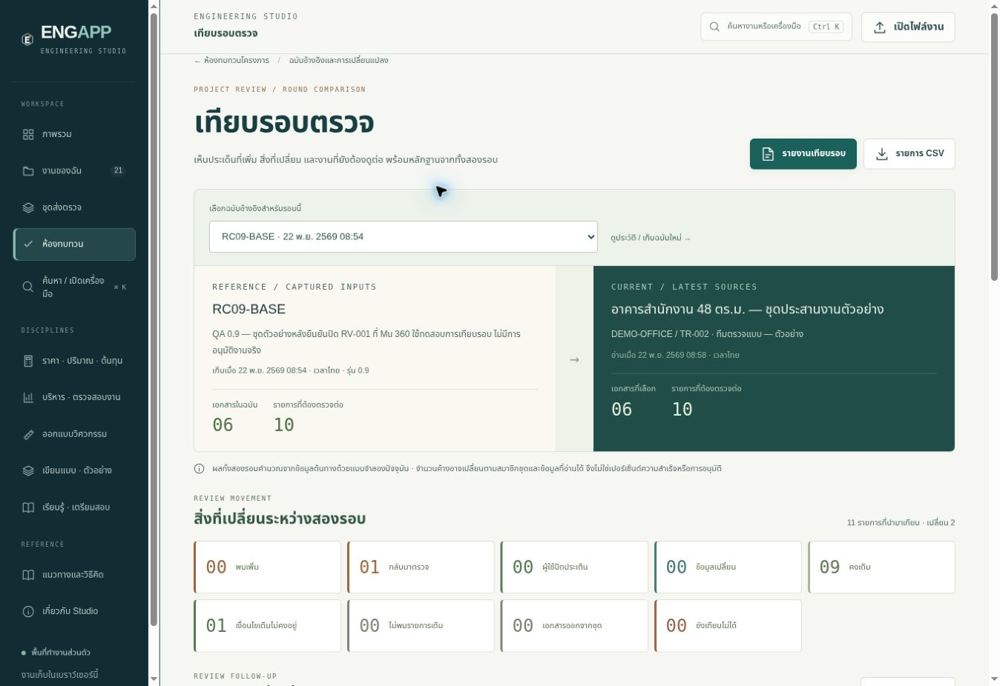
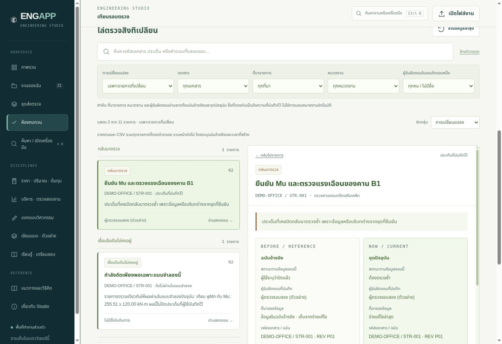
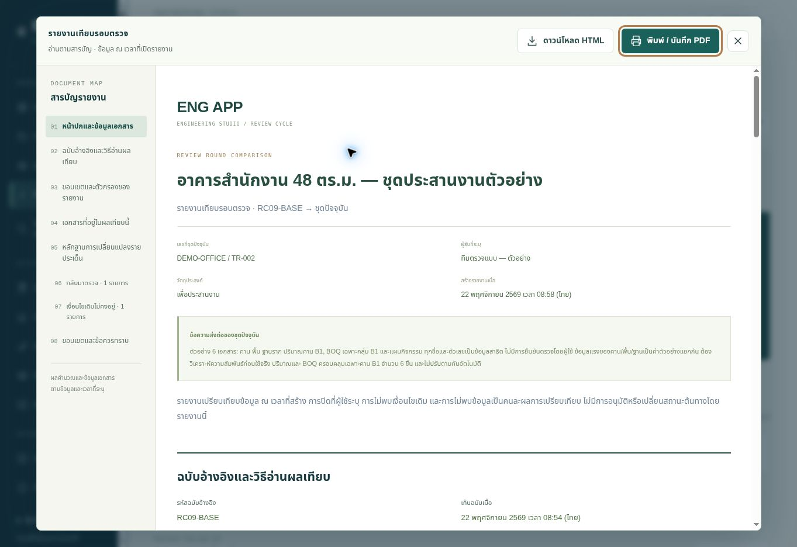
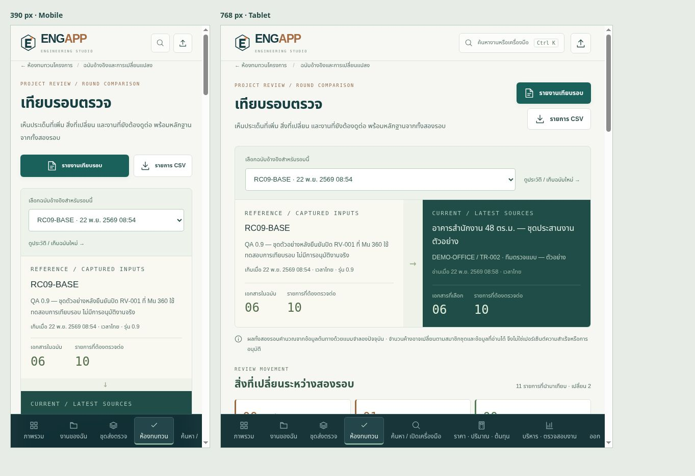

# Engineering Studio 0.9 — Review Round Comparison

Date: 22 November 2026 (Asia/Bangkok)

## Outcome

The new **เทียบรอบตรวจ** workspace compares a captured package reference with the current selected package. It shows which findings appeared, changed, remained the same, returned for review or were explicitly closed, alongside conditions that can no longer be observed and evidence that is missing. Each comparison keeps the reference and current details separate so a reviewer can read the reason before opening the source work.

This connects the package references introduced in 0.7 with the current Review Room introduced in 0.8. A reference supplies the earlier source inputs; the current package supplies the latest selected jobs and their applicable drafts. Both sides use the same current Review Room evaluator. The comparison derives its rows from those sources and does not create another editable issue register.

The workspace is available from the home page, the reference workspace, the Review Room and command search. A reference must be selected explicitly. If the selected reference is removed or becomes unreadable, the interface explains that condition and preserves its identity instead of choosing another reference.

## Working through a review round

1. Arrange the source jobs in **ชุดส่งตรวจโครงการ** and keep a package reference with a code and reason in **ฉบับอ้างอิง**. The existing archive retains the inputs, selected documents and package context at capture time.
2. Open **เทียบรอบตรวจ** and select the reference to compare. The two context panels identify the captured round and the current package, their document counts and derived outstanding findings.
3. Read the transition totals, then select a row to compare its reference and current evidence. The default queue shows changes and comparison limitations; **ดูทุกรายการ** also includes unchanged rows.
4. Use search or filter by transition, source document, finding type, discipline/category or recorded owner. Group the matching rows by transition or document.
5. Open the current source from a comparison row when that source is available. Review or edit the existing calculator register, pending text, document metadata or relevant result section there.
6. Use **กลับเทียบรอบตรวจ** to preserve the source draft and rebuild the comparison. The return keeps the selected reference and comparison row, including when the row has changed its transition or no longer matches the active filter.
7. Export the complete filtered comparison as CSV or open the indexed report. Reopening a report reads the latest sources; an already opened report retains its captured contents.

The comparison itself does not confirm a response, close an issue, check a declaration, capture another reference or change package membership. Those actions remain in their existing source workspaces.

## Exact identity and the two scopes

The earlier scope comes from the exact selected package reference. The current scope comes from the ordered handover selection, with the existing limit of 30 source documents. The comparison includes the union of those scopes so a document removed from the current package remains visible in the comparison.

Documents match by their internal source identity. A copied or imported job has a different identity even when its name, document code and calculator match the earlier job. Source-local issue IDs remain qualified by their document identity: two different jobs can each contain `RV-001` without those items being merged.

Model failures and unassessed results for the same check share a comparison identity based on the source, check index and check label. A check changing from failed to unassessed is therefore one changed observation with both states visible. Inspection defects use a unique authored inspection-row identity where that identity can be established, so reordering rows does not fabricate a removed defect. Missing or duplicated inspection identities cannot establish that a defect was repaired.

The current side uses the existing project-specific saved/draft resolution. A valid newer draft belonging to the selected job is included with its source label. A draft for another job in the same calculator is not substituted. Merely changing a save timestamp, document order or saved/draft label does not create a finding change.

Missing records, duplicated source identities and changed tool types remain explicit. Reusing a source identity with another tool prevents comparison across those different models. When the current job is still available, that case can offer a generic source action without pretending that the earlier finding belongs to the new tool.

## Nine distinct comparison results

Each row has one transition label and a reason derived from its source evidence. These labels describe the comparison; they are not a new set of editable source statuses.

| Transition | Meaning and evidence |
| --- | --- |
| **พบเพิ่ม** (`new`) | A current finding has no matching earlier finding within a scope that can be evaluated. Findings from a newly selected document identify that membership change in their reason. An unreadable earlier register cannot prove that an issue is new. |
| **กลับมาตรวจ** (`reopened`) | An earlier closed authored item is now outstanding, or an item newly requires contextual review. This can also apply to an earlier addressed item whose inputs or tracked context have changed. The earlier recorded response remains visible. |
| **ผู้ใช้ปิดประเด็น** (`closed`) | The same authored issue was outstanding and now has an explicitly recorded, contextually valid closure. The source register supplies the status and response. A passing model check or a removed row does not create this result. |
| **ข้อมูลเปลี่ยน** (`updated`) | The same finding has changed status, text, response, owner, priority, evidence or source target without meeting the specific reopening or closure rules. The changed fields are listed before and after. |
| **คงเดิม** (`unchanged`) | The finding's compared evidence remains the same. Already closed and unchanged items remain here; they are not counted as newly closed again. The default changes queue excludes these rows. |
| **เงื่อนไขเดิมไม่คงอยู่** (`cleared`) | Positive current evidence supports that the earlier condition is no longer observed within the tool's scope. Examples include the same model check now passing or the same uniquely identified inspection row being recorded as passing. This remains separate from authored issue closure. |
| **ไม่พบรายการเดิม** (`not-listed`) | The current data can be read but the original item is absent and there is insufficient evidence to establish closure or a positively cleared condition. Deleted authored issues and removed pending text retain this distinction. |
| **เอกสารออกจากชุด** (`removed-source`) | The earlier document is no longer selected in the current package. Its findings remain available as reference evidence; their removal from package membership does not resolve them. |
| **ยังเทียบไม่ได้** (`unavailable`) | Missing, ambiguous, invalid or incompatible evidence prevents a supported conclusion. An absent result caused by invalid inputs or a rejected review register is not presented as improvement. |

Positive clearing is specific to the earlier condition. For document preparation, the displayed context fields and declarations must be complete. For pending inspections, the earlier pending rows must remain uniquely identifiable with current recorded dispositions; deleting them does not prove that inspection was completed. A repaired input format clears the data condition, not every engineering or human review item on that document.

## Reading before and current evidence

The detail pane presents both sides independently: document and tool, source provenance, finding type, effective status, recorded owner, priority, title, detail, response, displayed evidence and warnings. A change table identifies the fields that differ. When a side has no finding, the pane explains the absence instead of copying evidence from the other side or inventing a resolved status.

The existing contextual register evaluator remains authoritative for authored issues. Changing calculation inputs or tracked project context after a response or closure can make that record **ต้องตรวจซ้ำ**. The comparison retains the earlier closure or response and the changed context as evidence. An addressed item remains outstanding until a valid closure is explicitly confirmed in the source register.

Unfinished review and revision text stays distinct from confirmed records. Selecting “closed” or typing another owner into a pending editor does not close or reassign the registered issue. Disappearing draft text does not prove that an answer was confirmed or a revision was captured.

Owner filtering matches a recorded name on either the reference or current side. This lets a reviewer find work whose recorded responsibility has changed while preserving the two names in the evidence. The filter uses literal names rather than fuzzy person matching, and the current row label continues to show current attribution when a current finding exists. Finding-type and category filters also match either side, so a change between categories is not hidden by looking only at its current label.

## Current-engine interpretation and counts

Both rounds are evaluated with the current model definitions. The reference capture time and app version describe the provenance of the retained inputs; they do not select or replay an older calculation engine. The report states both the capture version and the current comparison version. Source assumptions and the actual coverage of each tool continue to apply on both sides.

The context panels show document counts and derived outstanding counts for each scope. The transition summary shows how the matched and unmatched findings are classified. These counts answer different questions. They can change when package membership changes, data becomes unavailable or one source contributes several separate observations.

The workspace does not turn the difference between outstanding counts into a completion percentage, project safety score or approval status. Zero changed rows can mean that all comparable findings remain unchanged. Zero rows after filtering describes the filter scope and cannot establish that the project has been fully reviewed.

## Queue, detail and continuation

The screen shows **20 comparison rows per page**. Grouping and pagination affect presentation only; every matching row remains in the model and export scope. The detail view retains a selected row explicitly when it becomes filtered out or disappears after a refresh. The interface does not silently substitute the next row as though it were the same finding.

Navigation preferences retain the selected reference, filters, grouping, selected comparison identity, page and detail-pane state. They contain no copied finding evidence or independent resolution status. The layout includes separate queue/detail views at narrow widths, a return-to-queue action and contained scrolling for wide evidence tables.

The command palette opens the comparison workspace. `/` reaches its search field, `Ctrl`/`⌘` + `S` retains navigation preferences, and `Ctrl`/`⌘` + `P` opens the current filtered report. Live storage changes to references, selected package membership, saved projects or project drafts trigger a rebuild of a mounted comparison view.

## Exact-source return and draft preservation

Source URLs retain the exact local job identity and bounded target section, plus the comparison reference and selected comparison-entry identity. The entry identity is separate from the current Review Room finding identity: a positively cleared or deleted finding can still have comparison evidence even when it no longer exists in the current queue.

Opening a row first rebuilds the comparison and checks whether the current source is available. A surviving source can be opened at the relevant section without inventing a current finding. Missing or ambiguous source records do not fall back to the last job opened in the same tool.

Returning preserves dirty source work before leaving, then reads the latest source state. If draft persistence fails or throws, the source editor stays mounted, the complete source/return URL is retained and the user is directed to export JSON. A failed write is not treated as a successful return.

The existing concurrent-save protection may save edits as a new job when another tab has changed the original. In that case the source URL is rewritten to the new job while retaining the original comparison return context. The package continues to refer to its original selected source until the user changes membership. Returning does not silently replace that selection with the copy.

If the reference disappears while the source is open, the exact current source can still be read and the comparison context explains its unavailability. Returning preserves the missing reference selection and asks the user to choose a valid reference. These links navigate browser-local data; sharing a URL alone does not transfer the referenced jobs or archive.

## Complete filtered CSV and report

Both export actions rebuild the comparison from the exact selected reference and current sources before applying the active filters. They include **every matching row across every screen page**. A missing or unreadable reference prevents a new export instead of producing a successful-looking report from an older in-memory model.

The CSV has **69 columns**. It includes one explicit scope row even when no finding matches, followed by every matching comparison row. Its fields cover the current package context, captured reference identity/code/time/version/reason, current app version, filter scope, whole-comparison and matched counts, exact comparison and source identities, transition/reason, changed fields, membership, both sides' evidence, and current-source navigation information.

Reference and current finding fields are separate. They include their own tool, finding type, title, priority, effective status, recorded owner, source provenance, detail, response, evidence and warnings. A missing side is identified explicitly. The existing CSV serializer preserves quotes and multiline text, emits a UTF-8 byte-order mark and neutralizes formula-leading text for spreadsheet use.

The indexed report contains the current package cover, reference provenance, interpretation and filter scope, scoped and whole-comparison transition counts, the affected document register and the complete before/current evidence for each matching row. It labels owner/type/category filters as matching either side. Zero-match reports keep their context and explicit zero counts.

Opening the report captures its rendered content. Preview, standalone HTML download and print preparation use that captured content even when another tab changes source data or removes a reference. Closing and reopening creates a fresh comparison report. The standalone export embeds the local styles and uses the existing offline report reader without source-editing controls or executable report scripts.

## Storage scope and implementation

The comparison reads existing browser-local jobs, project-specific drafts, package membership and captured references. The only new persisted data is navigation preference state. Capturing, deleting and restoring references remain in the existing archive workflow, with its six-reference and 4 MiB limits; comparison reads do not rewrite archive evidence.

The implementation is split by responsibility:

- `review-cycle.js`: pure before/current comparison, exact identities, nine transitions, literal filters, grouping and counts.
- `review-cycle-view.js` and `review-cycle.css`: reference selection, transition summary, paginated queue, evidence detail and report styling.
- `review-cycle-report.js`: complete filtered report markup and the 69-column CSV contract.
- `review-source.js`: bounded reference routes, exact-source URLs and validated comparison return context, alongside the existing draft-preservation gate.
- `handover-history.js`: an additive reference-source adapter that validates captured evidence and returns independent source inputs for evaluation.
- `app.js`: fresh source/reference reads, navigation lifecycle, source return, report capture, keyboard actions and storage refresh.

Existing model equations and source registers continue to supply their results and recorded statuses. No server task store, user account, notification delivery, approval workflow, digital signature or tamper-proof audit log is added by this workspace.

## Focused verification

All **67 focused tests passed** on 22 November 2026: 33 comparison-core tests, 12 view/selection tests, 13 report/CSV tests and nine source-navigation tests. There were zero failures, skipped tests or cancellations in this focused run.

```bash
node --test tests/review-cycle.test.mjs tests/review-cycle-view.test.mjs tests/review-cycle-report.test.mjs tests/review-source.test.mjs
```

The core tests cover all transition meanings; repeated issue IDs across different documents; copied and removed sources; missing, duplicate and invalid data; confirmed versus pending closure; stale context and reopening; positive model/inspection clearing; inspection reordering and deletion; current-engine interpretation; literal owner filtering; and non-mutation of deeply frozen inputs. The capacity fixture retains all **900 authored issues** allowed by 30 selected calculators with 30 review items each.

The view tests cover explicit reference choice, missing-reference behavior, unchanged rows under the default filter, complete pagination, selected rows becoming filtered or absent, source-action availability and escaped before/current evidence. They verify the view's pure state and generated markup; they do not substitute for browser interaction.

The report tests cover separate before/current responses and owners, reference/version provenance, missing-side explanations, explicit zero-match scope, **47 matching rows** exported beyond a screen page, rectangular 69-column output, multiline Thai text, formula-leading values, HTML escaping and frozen-input non-mutation. Invalid models or timestamps reject rather than creating a misleading empty report.

The source tests cover special-character identities, exact reference and entry return context, malformed and repeated URL parameters, ambiguous or missing jobs, oversized links and failed/throwing draft-persistence callbacks. A read-only integration audit also traced fresh exports, frozen opened reports, storage refresh, source-return restoration and concurrent-copy URL handling without finding a P1/P2 issue in those paths.

The full integration suite passed **366/366 tests**, with zero failed, skipped or cancelled tests. Final release gates are `npm run check`, `npm test`, `npm run build` and `git diff --check`. Published-commit CI evidence is recorded on [PR #2](https://github.com/saratchai1/eng-app/pull/2).

## Browser verification

The following checks ran in the actual application on **22 November 2026 (Asia/Bangkok)**, using explicitly labeled local demonstration data:

- **Explicit selection and older reference:** the initial page required a reference. Selecting `PKG-P03` (captured in app 0.7) produced 12 comparisons: one new failed check, one issue newly requiring review, one absent pending-text item and nine unchanged rows. The absent draft was not described as closed.
- **Exact source, reload and either-side owner:** filtering the original owner and opening the beam issue navigated to the exact saved beam ID and review item. Reload preserved the reference/entry return context. Changing the demonstration owner and explicitly confirming closure retained the selected row and old-owner filter on return, showed both owner names, and classified the issue as user-closed.
- **Captured closed round and reopening:** a new `RC09-BASE` package reference retained the six-document scope with the demonstration issue closed at `Mu = 360 kN·m`. Comparing immediately produced zero changes. Changing `Mu` to **350 kN·m** reopened that issue with the specific earlier-closed reason and `360 → 350` evidence; the still-failed model check was a separate updated row.
- **Positive condition clearing stays separate:** changing `Mu` to **120 kN·m** produced a cleared model condition with the actual comparison **255.51 ≥ 120.00 kN·m**. The authored issue still required review and retained its recorded response. Passing the model check did not close the issue.
- **Reference removal and frozen report:** while a two-row comparison report was open, the demonstration reference was removed from a second tab through the reversible archive action. The already opened report text remained byte-for-byte unchanged and downloaded successfully. Closing the report revealed the missing-reference state with exports disabled and no fallback to another reference. Undo restored the exact selected reference and comparison.
- **Real pagination and complete exports:** selecting all **21 existing demonstration jobs** produced **38 comparison rows**. The changes filter matched **29 rows** across pages **20 + 9**, with 29 unique identities. CSV exported from page two contained all 29 findings plus its scope row; every row had **69 columns**. The report contained all 29 corresponding evidence entries across 16 documents.
- **Removed package member:** removing the planning document from the current selection produced **เอกสารออกจากชุด**, retained its reference evidence and explained that removal does not resolve the issue. The original six-document membership and order were restored after the larger-package checks.
- **Downloaded artifacts:** the actual two-row CSV had a header, scope row and two data rows, each with 69 fields. The downloaded HTML retained the selected reference and cleared-condition evidence, contained no scripts or external resource references, and had no duplicate IDs. Its embedded styles include the final readability polish.
- **Responsive interaction:** 390px and 768px browser frames had equal document scroll/client widths. On mobile, selecting a row showed the evidence view and hid the queue, the exact beam source opened, and returning restored the reference and issue. The mobile report index navigated to the reopened-issue section without horizontal document overflow.
- **Integration entry point:** the selected reference's **เทียบรอบตรวจ** action in the archive opened the exact matching reference in the new workspace.
- **Existing tool routes:** all **20** catalog routes rendered their expected tool heading. The comparison page recorded no application-origin console errors during the checks.

The screenshots below show the finished application:









The temporary responsive fixture was removed and the managed preview stopped after verification. Native operating-system print/PDF dialogs and physical mobile devices were not automated. Draft-quota failure and concurrent-copy return handling have focused helper tests and a code-path audit; this release did not deliberately exhaust browser storage or repeat the earlier concurrent-write browser scenario.

## Practical boundaries

The comparison describes the selected local package and its available retained evidence. It does not establish engineering continuity between independent calculators, synchronize quantities into BOQ rows or verify a complete multi-discipline design. A declared inspection result, authored closure and model check remain different kinds of evidence.

Names and recipients are recorded document text, with no account verification or automatic assignment. Moving work to another browser still uses the existing JSON job/package workflow. Review-round links and navigation preferences carry identities, not the underlying project data.

The existing model assumptions, 30-document package limit, 30-item calculator register limit, bounded workflow data and available browser storage continue to apply. The comparison makes missing and changed evidence visible so a reviewer can choose the next source action; it does not grant approval or replace project-specific engineering review.
